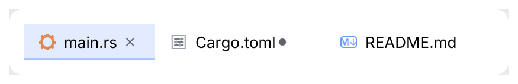

# TabBar

Editor-style tabs. The selected tab is tinted and underlined; tabs can show a file icon, an
unsaved-changes dot and a close button.

<picture>
  <source media="(prefers-color-scheme: dark)" srcset="img/tab_bar.dark.png">
  
</picture>

## Usage

```rust
use archipel_kit::components::{Tab, TabBar};
use archipel_kit::{Icon, egui};

fn editor_tabs(ui: &mut egui::Ui, files: &mut Vec<String>, current: &mut usize) {
    let tabs: Vec<Tab> = files
        .iter()
        .map(|name| Tab::new(name.as_str()).icon(Icon::for_file(name)).closable(true))
        .collect();
    let out = TabBar::new(&tabs, *current).show(ui);
    if let Some(index) = out.selected {
        *current = index;
    }
    if let Some(index) = out.closed {
        files.remove(index);
        *current = (*current).min(files.len().saturating_sub(1));
    }
}
```

## API

| Item | Effect |
|---|---|
| `Tab::new(label)` | A tab. `.icon(Icon)`, `.closable(bool)`, `.modified(bool)`. |
| `TabBar::new(&tabs, selected).show(ui)` | Returns `TabBarResponse { selected, closed }`. |

The caller owns the tab list and the selection; `show` only reports what the user did.

## Behavior

- Clicking a tab selects it; middle-clicking a closable tab closes it.
- The close button shows on the selected tab and on hover.

## Accessibility

Tabs are selectable items named by their label that report whether they are selected; close
buttons are named "Close <label>".

Source: [`components/segmented.rs`](../../crates/archipel-kit/src/components/segmented.rs) ·
Tests: [`tests/navigation.rs`](../../crates/archipel-kit/tests/navigation.rs)
