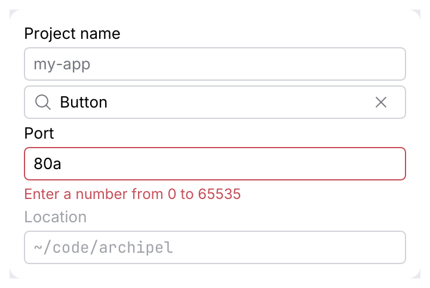

# TextField

A single-line text input with an optional label, placeholder, leading icon, clear button and
validation message. `TextField::search` is the preset for filter and search boxes.

<picture>
  <source media="(prefers-color-scheme: dark)" srcset="img/text_field.dark.png">
  
</picture>

## Usage

```rust
use archipel_kit::components::TextField;
use archipel_kit::egui;

fn connection_form(ui: &mut egui::Ui, host: &mut String, port: &mut String) {
    ui.add(TextField::new(host).label("Host").placeholder("localhost"));
    let error = port.parse::<u16>().is_err().then_some("Enter a number from 0 to 65535");
    ui.add(TextField::new(port).label("Port").error(error));
}
```

## API

| Builder | Effect |
|---|---|
| `TextField::new(&mut String)` | Edits the string in place. |
| `TextField::search(&mut String)` | Magnifier icon, "Search" placeholder, clear button. |
| `.label(str)` | Visible label above the input, also its accessible name. |
| `.placeholder(str)` | Hint shown while empty. |
| `.error(Option<str>)` | Error outline and message below; `None` clears it, so `.error(validate(&text))` works. |
| `.leading_icon(Icon)` | Icon inside the input, before the text. |
| `.clearable(bool)` | Clear button while the input has text. |
| `.password(bool)` | Masks the text. |
| `.monospace(bool)` | Code font, for paths, URLs and ids. |
| `.enabled(bool)` | Disabled inputs are dimmed and read-only. |
| `.highlighter(&dyn Highlighter)` | Colors the text (URLs, `{{variables}}`); see [single-line fields](code.md#single-line-fields-and-variables). |
| `.width(f32)` | Total width (default: the available width). |

Returns the text edit's `Response`: `changed()` after each edit, `lost_focus()` when the user
leaves the field. `.show(ui)` returns a `TextFieldOutput` instead: the response, `submitted`
(<kbd>Enter</kbd>), the `caret_rect` and the `{{variable}}` at the caret, for autocomplete.

## Behavior

- Focus draws a 2 pt accent outline; an error keeps the outline red.
- The clear button empties the field and keeps the focus in it.

## Accessibility

Role `TextInput` (or `PasswordInput`), labelled by the visible label. The error message is
also the input's tooltip.

## Testing

```rust
use archipel_kit::components::TextField;
use archipel_kit::testing::{self, Queryable};
use archipel_kit::Theme;

let mut harness = testing::harness_state(Theme::dark(), String::new(), |ui, text| {
    ui.add(TextField::new(text).label("Name"));
});
let input = harness.get_by_label("Name");
input.focus();
input.type_text("archipel");
harness.run();
assert_eq!(harness.state(), "archipel");
```

Source: [`components/text_field.rs`](../../crates/archipel-kit/src/components/text_field.rs) ·
Tests: [`tests/text_field.rs`](../../crates/archipel-kit/tests/text_field.rs)
