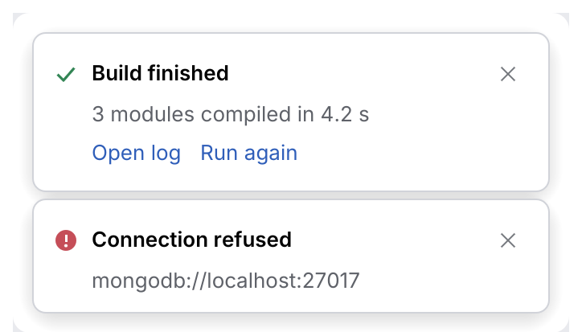

# Toast

A notification card with an icon, title, optional body and link actions. Draw it inside a
panel with `show`, or float it in the window's bottom-right corner with `show_corner`.

<picture>
  <source media="(prefers-color-scheme: dark)" srcset="img/toast.dark.png">
  
</picture>

## Usage

```rust
use archipel_kit::components::{Severity, Toast};
use archipel_kit::egui;

struct Notification {
    id: u64,
    title: String,
}

fn notifications(ctx: &egui::Context, list: &mut Vec<Notification>) {
    let mut dismissed = None;
    for (index, n) in list.iter().enumerate() {
        let out = Toast::new(Severity::Info, n.title.as_str())
            .action("Open")
            .show_corner(ctx, n.id, index);
        if out.dismissed {
            dismissed = Some(index);
        }
    }
    if let Some(index) = dismissed {
        list.remove(index);
    }
}
```

## API

| Builder | Effect |
|---|---|
| `Toast::new(Severity, title)` | A card. |
| `.body(str)` | Detail text. |
| `.action(label)` | A link; `MessageResponse::action` is its index. |
| `.show(ui)` | Draws it in place (320 pt wide). |
| `.show_corner(ctx, id, index)` | Floats it bottom-right, stacked upwards by `index`. |

Timing out a toast is up to the app (store when it appeared, remove it later).

Source: [`components/feedback.rs`](../../crates/archipel-kit/src/components/feedback.rs) ·
Tests: [`tests/feedback.rs`](../../crates/archipel-kit/tests/feedback.rs)
