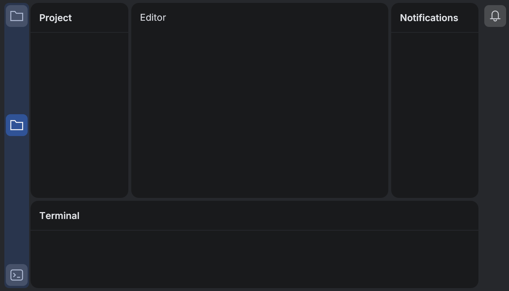
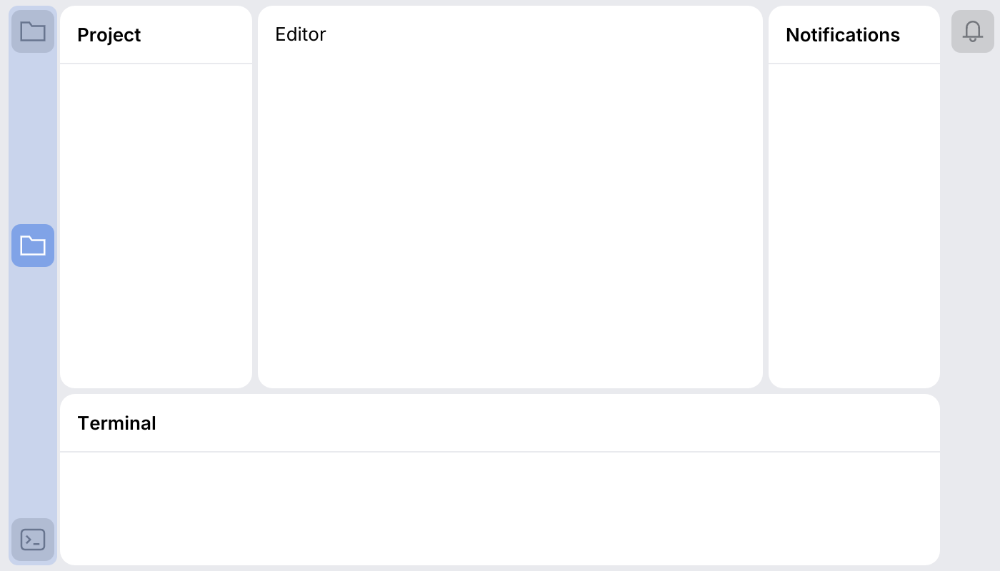
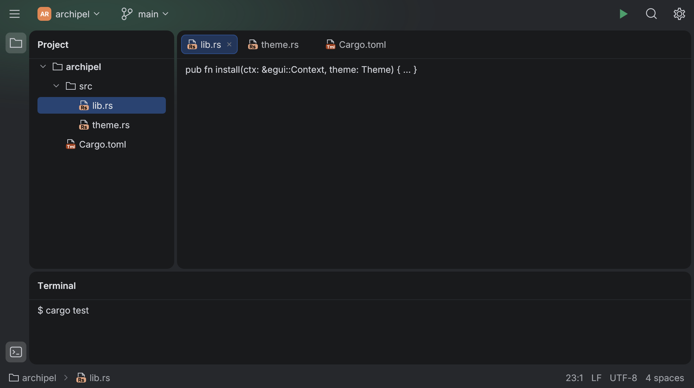
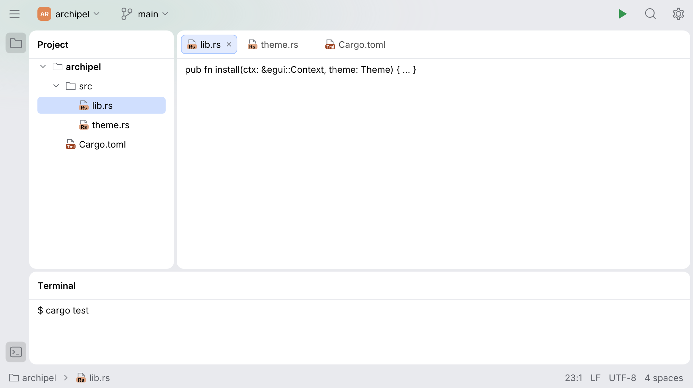
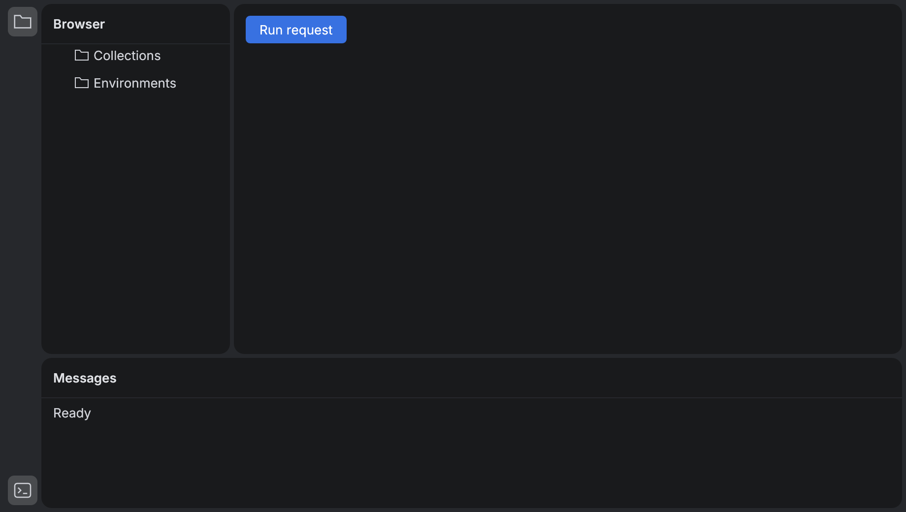
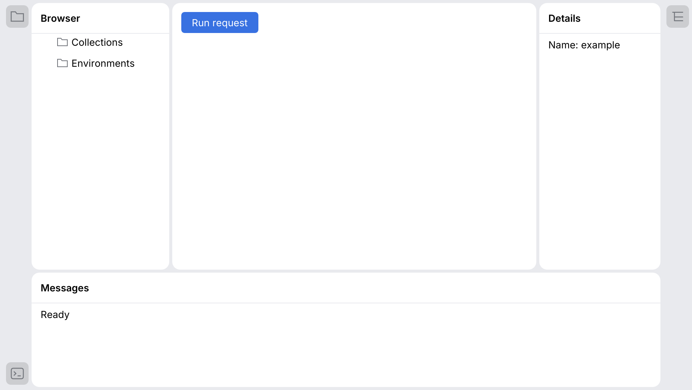

# ToolWindowPane

`ToolWindowPane` assembles a center island and optional left, right and bottom tool windows.
All gutters and splitters use the kit tokens. Its optional toolbar uses `MainToolbar`;
the optional status area stays on the themed frame. Applications supply the content.

```rust
use archipel_kit::wm::{StatusBarWidget, IdeFrameDecorator, ToolWindowPane, ToolWindowAnchor, ToolWindowPaneState};
use archipel_kit::Glyph;
let mut state = ToolWindowPaneState::default();
# egui::__run_test_ctx(|ctx| {
ToolWindowPane::new("workspace", &mut state)
    .toolbar(IdeFrameDecorator::Integrated, |ui| { ui.label("My application"); })
    .left("Browser", |ui| { ui.label("Collections"); })
    .right("Details", |ui| { ui.label("Properties"); })
    .padded(ToolWindowAnchor::Right, true)
    .bottom("Messages", |ui| { ui.label("Ready"); })
    .padded(ToolWindowAnchor::Bottom, true)
    .icon(ToolWindowAnchor::Bottom, Glyph::Terminal)
    .status(|ui| { ui.add(StatusBarWidget::new("UTF-8")); })
    .show(ctx, |ui| { ui.label("Document"); });
# });
```

`ToolWindowAnchor` identifies the left, right or bottom maximized tool window.

## One closure for the whole window

An application usually has one state that every region reads and writes. Declare the
places and fill them from one closure, so the state is borrowed once:

```rust
use archipel_kit::wm::{StatusBarWidget, IdeFrameDecorator, ToolWindowPane, ToolWindowPlace, ToolWindowAnchor, ToolWindowPaneState};
use archipel_kit::{Glyph, egui};

struct App { layout: ToolWindowPaneState, sent: u32 }

fn window(ctx: &egui::Context, app: &mut App) {
    let App { layout, sent } = app;
    ToolWindowPane::new("nexus", layout)
        .with_toolbar(IdeFrameDecorator::Integrated)
        .tool(ToolWindowAnchor::Left, "Collections", Glyph::Folder)
        .tool(ToolWindowAnchor::Right, "Response", Glyph::Structure)
        .with_status()
        .show_with(ctx, sent, |place, ui, sent| match place {
            ToolWindowPlace::Center => { /* request editor */ }
            ToolWindowPlace::Status => { ui.add(StatusBarWidget::new(format!("{sent} sent"))); }
            _ => {}
        });
}
```

`.tool_tabs(region, labels)` puts content tabs in a tool window's header, after its title,
like Android Studio's Problems tool window; the selection is `ToolWindowPaneState::tool_tab(region)`,
kept with the layout, and the next frame shows it.

`ToolWindowPlace` is `Center`, `Tool(region)`, `ToolActions(region)` (header buttons of that tool window, before Maximize and Hide), `Toolbar` or `Status`.

## Tool windows, contents and events

`ToolWindow` (id, title, icon, `ToolWindowAnchor`, `activate_number`) and its `ContentManager`
of `Content`s (the header tabs) are caller-owned state, like IntelliJ's `ToolWindow` and
`ContentManager`; whether a window is shown is in `ToolWindowPaneState`, which plays
`ToolWindowManager` (`is_visible`, `show`, `hide`, `hide_all`).

```rust
use archipel_kit::wm::{
    Content, ToolWindow, ToolWindowAnchor, ToolWindowEvent, ToolWindowPane, ToolWindowPaneState,
    ToolWindowPlace,
};
use archipel_kit::{Glyph, egui};

struct App { layout: ToolWindowPaneState, problems: ToolWindow }

fn window(ctx: &egui::Context, app: &mut App) {
    let App { layout, problems } = app;
    ToolWindowPane::new("ide", layout)
        .tool_window(problems) // anchor, title, icon, Alt+6 and the header tabs
        .show_with(ctx, &mut (), |place, ui, _| match place {
            ToolWindowPlace::Center => { ui.label("Editor"); }
            ToolWindowPlace::Tool(ToolWindowAnchor::Bottom) => { ui.label("No problems"); }
            _ => {}
        });
    for event in layout.take_events() {
        match event {
            ToolWindowEvent::FocusEditor(_) => { /* focus the editor */ }
            ToolWindowEvent::Activated(_anchor) => { /* focus the tool window's content */ }
            _ => {}
        }
    }
}

fn setup() -> App {
    let mut problems =
        ToolWindow::new("problems", "Problems", Glyph::Warning, ToolWindowAnchor::Bottom)
            .activate_number(6);
    problems.contents.add_content(Content::new("file", "File"));
    problems.contents.add_content(Content::new("project", "Project Errors"));
    App { layout: ToolWindowPaneState::default(), problems }
}
```

| Builder | Effect |
|---|---|
| `.tool_window(&mut ToolWindow)` | Declares the region from the description; its contents become the header tabs; selecting writes `ContentManager::select_index`, closing a closeable tab removes it. |
| `.activate_with(region, digit)` | `Alt+digit` (the stripe tooltip shows it). |
| `.header_actions(region, &dyn ActionGroup, &DataContext)` | Header buttons from an action group (place `TOOLWINDOW_TITLE`). |
| `.options_menu(region, &dyn ActionGroup)` | The gear and the right click menu (place `TOOLWINDOW_POPUP`). |

For other layouts, `ToolWindowToolbar::show_with_events(ui)` returns a `StripeResponse`
(`clicked`, `close_clicked`, `popup`, `dropped`, `rect`) instead of just the clicked index.

### Events and keys (IntelliJ spec sections 8.1 to 8.3)

`ToolWindowPaneState::take_events()` returns what happened since the last call as
`ToolWindowEvent`s; the pane applies the layout changes itself.

| Input | Layout | Event |
|---|---|---|
| Left click on a header | | `Activated(anchor)` |
| Double click on a header | toggles maximize | `MaximizeToggled(anchor, now_maximized)` |
| Middle click or Shift + click on a header or stripe button | hides | `Hidden(anchor)` |
| Right click on a header (no options menu) | | `HeaderMenuRequested(anchor, pos)` |
| Stripe button: left click | toggles shown/hidden | `Activated` when shown, `Hidden` when hidden |
| Stripe button: right click | | `StripeMenuRequested(anchor, pos)` |
| Stripe button: drag more than 7 pt, drop on another group, <kbd>Esc</kbd> cancels | | `MovedToAnchor { window, to }` (the app moves the window) |
| <kbd>Alt</kbd>+digit | hidden: shows; active: hides; visible: nothing | `Activated` / `Hidden` / `Activated` |
| <kbd>Shift</kbd>+<kbd>Esc</kbd> | hides the active tool window | `Hidden(anchor)` |
| <kbd>Ctrl</kbd>+<kbd>Shift</kbd>+<kbd>F12</kbd> | hides all | `AllHidden` |
| <kbd>Ctrl</kbd>+<kbd>Shift</kbd>+<kbd>'</kbd> | maximizes or restores the active one | `MaximizeToggled` |
| <kbd>Esc</kbd> with the focus in a tool window and no text field focused | | `FocusEditor(anchor)` |
| Middle or Shift + click on a closeable content tab | removes the content | `ContentCloseRequested(anchor, index)` |

The active tool window is the one that has the keyboard focus. A text field that has the
focus keeps <kbd>Esc</kbd> (it clears itself first). egui drops the focus on <kbd>Esc</kbd>, so the pane
remembers which window had it in the previous frame.




While a stripe button is dragged, a ghost of it follows the pointer and the stripe under the
pointer is highlighted as the drop target.

Deferred (no counterpart in the kit yet): the 13 pt resize zone at the top of a bottom tool
window's header (the 4 pt gap between islands is the divider and already resizes),
`ResizeToolWindow*` keyboard resizing, `JumpToLastWindow` (<kbd>F12</kbd>), the stripe "More" overflow button,
sliding (floating) tool windows. A stripe click on a visible but inactive window hides it
(the spec's "activate if inactive" would hide the button's toggle; kept as measured).

## Islands behavior

As in the IntelliJ / Android Studio Islands UI:

- **Gaps are the dividers.** The 4 pt frame-colored gap between islands has no line; the
  pointer shows the resize cursor over it (`Splitter::line(false)`). Tab still reaches each
  divider, which then shows the focus ring.
- **Header actions appear on hover.** A tool window's Maximize/Restore and Hide buttons
  show at once while the pointer is anywhere over that island, header or body, or focus is
  inside it, and fade out 200 ms after it leaves (timing and narrow-island rules: see
  [SimpleToolWindowPanel](simple-tool-window-panel.md#composable-island-headers)). Hidden, they keep their names and Tab order.
- **Tool window stripes.** `.icon(region, glyph)` puts the region's button on a stripe on
  the frame: the left stripe holds the left tool window (top group) and the bottom one
  (bottom group), the right stripe the right one. A button is filled while its tool window
  is open; clicking it opens or closes it, so a hidden tool window always has a way back.
  Its tooltip (name, shortcut) appears beside it. Stripes are 38 pt wide with 30 pt buttons
  on a 40 pt pitch and 20 pt icons, so the islands start 42 pt from the window edge, as in
  Android Studio. `ToolWindowToolbar` and `SquareStripeButton` are public for other layouts.
- **Bodies are edge to edge** by default, so trees, lists and consoles bring their own row
  inset. `.padded(ToolWindowAnchor::Right, true)` gives a form or text body the content inset.


The caller owns `ToolWindowPaneState`, which supports serde serialization independently of
egui. Drag or use the splitter arrow keys to resize; Enter collapses or expands its tool
window. Headers expose named Hide and Maximize/Restore buttons. To reopen a hidden pane,
set its `*_hidden` flag to false from the application's navigation or shortcut.

Small viewports temporarily hide right, then left tool windows to preserve the central
work area. A short viewport hides the bottom pane. Preferred ratios and explicit hidden
flags are retained, so panes return when the window grows. Missing or hidden maximized
panes return to the center. Hidden content callbacks are not invoked.

`show_inside` embeds only the docked islands into a bounded UI area. `show` additionally
supplies the outer gutter, toolbar and status area. Floating windows, tool-window
stripes, multiple tools per region, and SDK/app migration remain separate follow-ups;
this component does not silently store unsupported layout modes.

The frame behind the islands is one surface, as in Android Studio: the toolbar, the
stripes and the status bar sit on it, and the project glow runs across all of them. A
plugin view embedded with `show_inside` in a host window that already drew that frame
passes `.frame_background(false)`; otherwise it paints its own frame over the host's and
the glow stops at a hard edge around the embedded islands.

## A whole window

`workbench_ide` is built only from kit components, laid out like Android Studio: a toolbar
with the main menu, a project widget (`ToolbarComboButton` + `Avatar`) and the project color's
glow, stripes, a project tree, an editor island with `JBTabs` (`.center_padded(false)` keeps
the tabs at the island's top) and a terminal.








