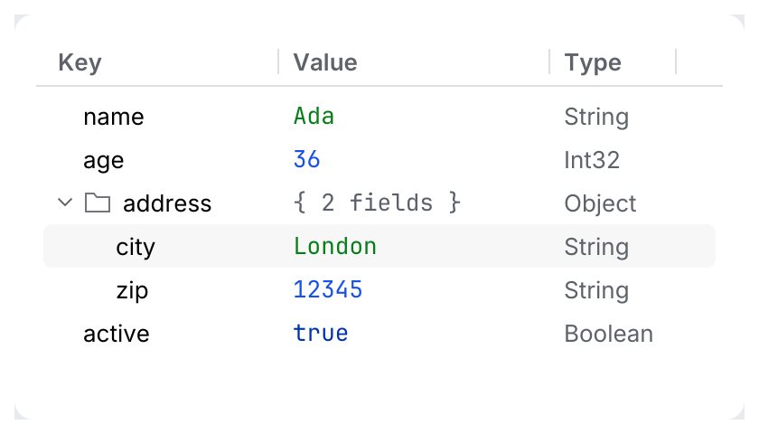
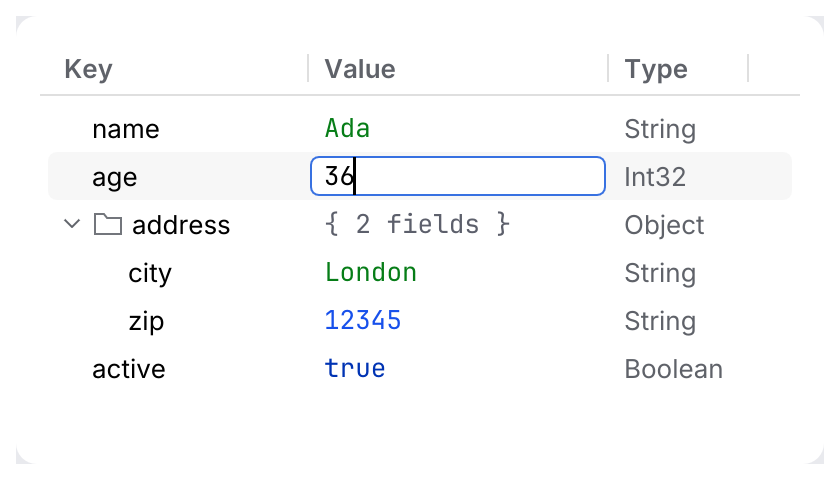

# TreeTable

A tree whose rows have columns: a MongoDB document or nested JSON as **key | value | type**.
It is [`Tree`](collections.md) and [`Table`](collections.md) in one, with the same model, and
draws only the visible rows, so 100 000 rows stay fast.

<picture>
  <source media="(prefers-color-scheme: dark)" srcset="img/tree_table.dark.png">
  
</picture>

## The model

- **You own the data**, the selection, the expanded state and the column widths. You pass the
  *visible* rows as `TreeRow`s (as for `Tree`) and a `cell(row, column)` callback for the
  columns after the first.
- **The first column is the tree column**: chevron, icon, key and dimmed secondary text come
  from the `TreeRow`.
- **The widget owns the keys** and reports through the same `CollectionResponse`:
  `selection_changed`, `activated`, `toggled`, `sort_clicked`, plus `edited`.

## Inline edit

<picture>
  <source media="(prefers-color-scheme: dark)" srcset="img/tree_table_edit.dark.png">
  
</picture>

Edit is a **cell slot plus a result**, not a callback that owns state:

- Mark cells `Cell::editable(true)` (the key column with `TreeRow::editable(true)`).
- <kbd>F2</kbd>, <kbd>Enter</kbd> or a double-click on an editable cell opens a text field in
  the cell (placed through a [`Slot`](../../crates/archipel-kit/src/parts/slot.rs), so it is
  a widget in the cell like any slot content).
- <kbd>Enter</kbd> commits, <kbd>Escape</kbd> cancels. Leaving the field (a click elsewhere)
  commits. Scrolling the row out of view cancels.
- A commit arrives as `CollectionResponse::edited`: a `CellEdit` with the row, the column and
  the new text. **The widget never changes your data**: validate, store and show the text from
  your callback. Until you do, the cell shows the old text again.

`row` in `edited`, `activated` and `toggled` refers to the rows drawn this frame: handle `edited` and `activated` before you flip expanded state and rebuild the rows (a click on a chevron while a field is open reports both).

<kbd>F2</kbd> and <kbd>Enter</kbd> edit the column you last clicked, or the first editable
column of the row. A row with nothing editable there still activates on <kbd>Enter</kbd>.
A double-click on a *non-editable* cell toggles a parent or activates a leaf, as in `Tree`.

## Usage

```rust
use archipel_kit::components::{Cell, Column, TreeRow, TreeTable};
use archipel_kit::{Glyph, ValueKind, egui};

struct Doc {
    columns: Vec<Column>,
    selected: Option<usize>,
    address_open: bool,
    name: String,
}

fn document(ui: &mut egui::Ui, doc: &mut Doc) {
    let mut rows = vec![
        TreeRow::new("name", 0),
        TreeRow::new("address", 0).icon(Glyph::Folder).parent(doc.address_open),
    ];
    if doc.address_open {
        rows.push(TreeRow::new("city", 1));
    }
    let name = doc.name.clone();
    let out = TreeTable::new("document", &mut doc.columns, &rows, &mut doc.selected)
        .name("Document")
        .show(ui, |row, col| match (row, col) {
            (0, 1) => Cell::new(name.as_str()).value_kind(ValueKind::String).editable(true),
            (1, 1) => Cell::new("{ 1 field }").value_kind(ValueKind::Punctuation),
            (_, 1) => Cell::new("London").value_kind(ValueKind::String),
            (1, _) => Cell::new("Object").muted(),
            _ => Cell::new("String").muted(),
        });
    if out.toggled.is_some() {
        doc.address_open = !doc.address_open;
    }
    if let Some(edit) = out.edited {
        if (edit.row, edit.column) == (0, 1) {
            doc.name = edit.text;
        }
    }
}
```

## API

| Item | Builders and fields |
|---|---|
| `TreeTable::new(id, &mut columns, &rows, &mut selected)` | `.sort(Option<(column, SortOrder)>)`, `.name(str)`, `.height(f32)`, `.show(ui, \|row, column\| Cell)` |
| `TreeRow` | `.editable(bool)` for the key, plus `.parent`, `.icon`, `.icon_tone`, `.secondary` as for `Tree` (`.busy` is for `Tree` only) |
| `Cell` | `.editable(bool)`, `.value_kind(ValueKind)` (values in the editor's syntax colors, see [collections](collections.md#typed-values)), plus `.icon`, `.tone`, `.tag(Tone)`, `.muted` as for `Table` |
| `CellEdit` | `row`, `column`, `text` |
| `CollectionResponse` | `selection_changed`, `activated`, `toggled`, `sort_clicked`, `edited` |

## Behavior

- **Keys.** <kbd>↑</kbd>/<kbd>↓</kbd>, <kbd>Home</kbd>/<kbd>End</kbd>, <kbd>PgUp</kbd>/<kbd>PgDn</kbd>
  move the selection; <kbd>→</kbd> expands a collapsed node or moves to its first child,
  <kbd>←</kbd> collapses an expanded node or moves to its parent; <kbd>Enter</kbd> or a
  double-click activates.
- **Columns** resize by dragging the edge of a header (minimum 40 points); clicking a header
  reports `sort_clicked`. Cells clip at the column edge.
- **Cursors.** Rows keep the arrow, headers the pointing hand, the resize handle the column
  resize cursor, and the edit field the text beam (see [cursors](../cursors.md)).
- **States.** Hover and the selection pill as in `Table`; the selection is blue while the
  collection has focus and gray otherwise; the focus ring shows when nothing is selected.

## Accessibility

The collection is a tree grid named with `.name(...)`. Rows are selectable labels named by
their key and cells joined with commas (`name, Ada, String`); chevrons are buttons
(`Expand address`); headers are buttons; resize handles are splitters (`Resize Key`). The
open editor is a text input named `Edit <column title>`.

Source: [`components/collections/tree_table.rs`](../../crates/archipel-kit/src/components/collections/tree_table.rs),
[`edit.rs`](../../crates/archipel-kit/src/components/collections/edit.rs) ·
Tests: [`tests/collections.rs`](../../crates/archipel-kit/tests/collections.rs),
[`tests/conformance.rs`](../../crates/archipel-kit/tests/conformance.rs)
