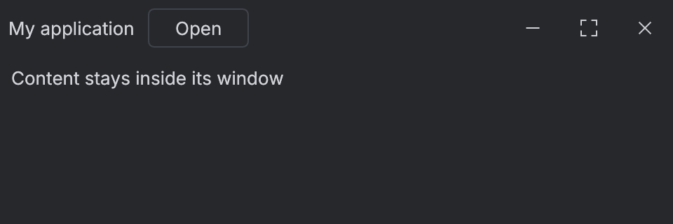
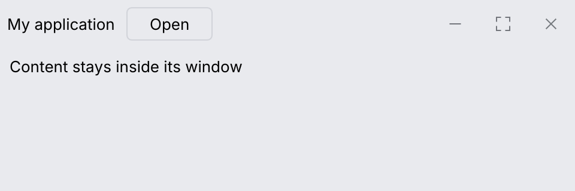
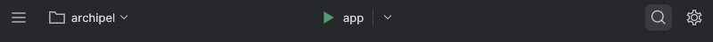
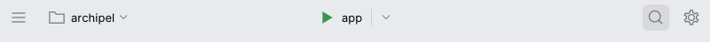

# Window toolbar

`IdeFrameDecorator` configures the host viewport; `MainToolbar` draws the matching themed
toolbar. On macOS, `Integrated` keeps the native traffic lights alongside your content,
without an extra native title strip. Empty toolbar space drags the window; double-click
maximizes or restores it. Child controls retain their own input.

```rust
use archipel_kit::{egui, ui::Button, wm::{IdeFrameDecorator, MainToolbar}};
let viewport = IdeFrameDecorator::Integrated.viewport(
    egui::ViewportBuilder::default().with_title("My application")
);
# egui::__run_test_ctx(|ctx| {
MainToolbar::new("main-toolbar").chrome(IdeFrameDecorator::Integrated).show(ctx, |ui| {
    ui.label("My application");
    ui.add(Button::secondary("Open"));
});
# });
```

Pass `viewport` to your host's window options before creating the window. Use the same
chrome mode when rendering its toolbar. In the host's update callback, also call
`IdeFrameDecorator::Integrated.align_native_controls("My application", ctx)`.
This centers the actual macOS traffic lights in the full toolbar height, including after
native resize relayout, and applies the theme's frame color to the native backing window.
It also makes the green button zoom the
window (fill the screen) instead of moving it into a macOS full-screen space: in a
full-screen space macOS hides the traffic lights and slides its own empty title bar over
the toolbar when the pointer reaches the top edge. Zoomed, the toolbar and the traffic
lights stay where they are. The title must
uniquely identify a window in your process. The helper returns false if the window or UI
thread is unavailable; it uses safe AppKit bindings and does not create replacement icons.
`Native` is the default and retains the normal
native title bar. `Integrated` retains native decorations on Windows and Linux;
their title-bar integration has not been verified here. `Borderless` supplies named,
keyboard-accessible minimize, maximize/restore and close buttons using the existing kit
icons. Its host must provide border resizing where custom hit testing is required.

The toolbar reserves space for macOS native controls and clips content to its available
width. Hosts should set a sensible minimum window size for their toolbar actions.




The snapshots show the portable `Borderless` mode. Native traffic lights belong to the
operating system and are checked in the running macOS gallery.

## Zones, context menu and window controls (IntelliJ spec §14)

`MainToolbar::show_zones(ctx, left, center, right)` lays the toolbar out like IntelliJ's main
toolbar: the left zone (main menu button, project and version control widgets), the center zone
(the run widget, centered in the window), and the right zone (search everywhere, settings,
account), right-aligned. The center and right zones are positioned from their width in the
previous frame, so the first frame after a change can be a frame late.




- `.context_menu(&group, &context)`: right click on the empty background opens the group as an
  `ActionPopupMenu` (IntelliJ's "Customize Toolbar"). Buttons and widgets keep their own
  clicks.
- With focus on one of the toolbar's controls (IntelliJ's `FocusMainToolbar`), <kbd>←</kbd> and
  <kbd>→</kbd> move focus to the neighbor (text fields keep their arrows). The buttons are in
  the Tab order only with `ActionButton::focusable(true)` or a screen reader; there is no
  default key to focus the toolbar, as in IntelliJ.
- Borderless windows get 40 × 40 pt title pane buttons (`TitlePane.Button.preferredSize`) with a
  square hover fill, flush with the window's edge.
- `ToolbarSplitButton::new(text).icon(..)` is the run widget: an action part and a 26 pt chevron
  part divided by a 20 pt line with 3 pt margins (`MainToolbar.SplitDropdown`); `show(ui)`
  returns a `ToolbarSplitResponse` with the `main` and `arrow` responses, and `.open(true)` keeps the arrow filled while its list
  is open. Open the list with `ListPopup` or `ActionPopupMenu` anchored to the arrow.
- `ToolbarComboButton` grows to at most 350 pt (`MainToolbar.Dropdown.maxWidth`); longer text is
  elided with an ellipsis. Its radius stays at the measured 6 pt (IntelliJ's `arc` 12) and its
  chevron margin at the measured 8 pt.

```rust
# egui::__run_test_ctx(|ctx| {
use archipel_kit::{Glyph, action_system::ActionButton, wm::{MainToolbar, ToolbarComboButton, ToolbarSplitButton}};

MainToolbar::new("main-toolbar").show_zones(
    ctx,
    |ui| {
        ui.add(ActionButton::new(Glyph::Menu, "Main menu").large(true));
        let _ = ToolbarComboButton::new("archipel").dropdown(true).show(ui);
    },
    |ui| {
        let run = ToolbarSplitButton::new("app").icon(Glyph::Run).show(ui);
        if run.arrow.clicked() { /* open the configurations list */ }
    },
    |ui| {
        ui.add(ActionButton::new(Glyph::Search, "Search everywhere").large(true));
        ui.add(ActionButton::new(Glyph::Settings, "Settings").large(true));
    },
);
# });
```

## Toolbar controls

Measured on Android Studio's main toolbar (`tokens::toolbar`):

- `ToolbarComboButton::new(text)` is a flat text widget like Android Studio's project and version
  control widgets: 30 pt high, radius 6, 10 pt before the text, optional 20 pt `.icon(..)` or
  `.leading(slot)` (e.g. an `Avatar` as the project tile) 8 pt in, and a chevron with
  `.dropdown(true)`. Hover and press fill it; `.open(true)` keeps it filled while its menu
  (a `JBPopup` anchored to the response) is open.
- `ActionButton::large(true)` is the 30 pt toolbar icon button with a 20 pt icon.
- The toolbar keeps 6 pt from the window's edges, so the main menu button sits right above
  the stripe buttons, and puts 10 pt between controls.
- `.project_color(color)` paints Android Studio's soft glow of the project's color behind the
  project widget (`parts::project_glow`): the color itself at 26 % in dark themes, a pastel of
  it in light ones. `ToolWindowPane::project_color` continues it over the top of the stripes.

```rust
# egui::__run_test_ctx(|ctx| {
use archipel_kit::{ui::Avatar, action_system::ActionButton, wm::{ToolbarComboButton, MainToolbar}};
use archipel_kit::{Glyph, egui, parts::Slot};

MainToolbar::new("main-toolbar")
    .project_color(egui::Color32::from_rgb(0x4C, 0xA0, 0x74))
    .show(ctx, |ui| {
        ui.add(ActionButton::new(Glyph::Menu, "Main menu").large(true));
        let _ = ToolbarComboButton::new("archipel")
            .leading(Slot::ui_width(20.0, |ui| { ui.add(Avatar::new("archipel").size(20.0)); }))
            .dropdown(true)
            .show(ui);
        let _ = ToolbarComboButton::new("main").icon(Glyph::Branch).dropdown(true).show(ui);
    });
# });
```
