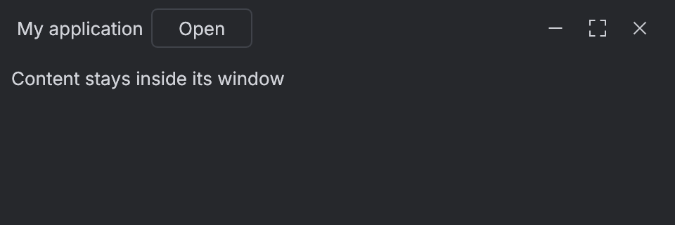
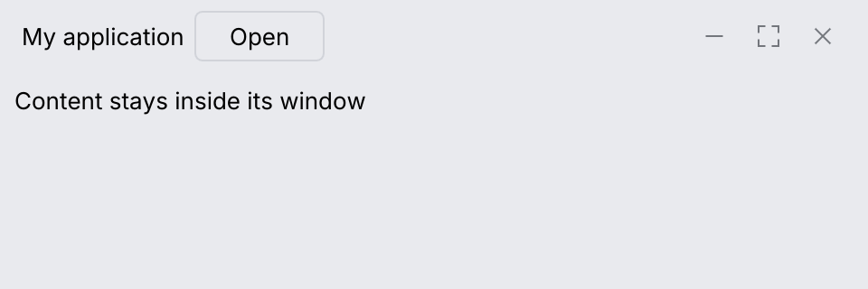

# Window toolbar

`WindowChrome` configures the host viewport; `WindowToolbar` draws the matching themed
toolbar. On macOS, `Integrated` keeps the native traffic lights alongside your content,
without an extra native title strip. Empty toolbar space drags the window; double-click
maximizes or restores it. Child controls retain their own input.

```rust
use archipel_kit::{egui, components::{Button, WindowChrome, WindowToolbar}};
let viewport = WindowChrome::Integrated.viewport(
    egui::ViewportBuilder::default().with_title("My application")
);
# egui::__run_test_ctx(|ctx| {
WindowToolbar::new("main-toolbar").chrome(WindowChrome::Integrated).show(ctx, |ui| {
    ui.label("My application");
    ui.add(Button::secondary("Open"));
});
# });
```

Pass `viewport` to your host's window options before creating the window. Use the same
chrome mode when rendering its toolbar. In the host's update callback, also call
`WindowChrome::Integrated.align_native_controls("My application", ctx)`.
This centers the actual macOS traffic lights in the full toolbar height, including after
native resize relayout, and applies the theme's frame color to the native backing window.
The title must
uniquely identify a window in your process. The helper returns false if the window or UI
thread is unavailable; it uses safe AppKit bindings and does not create replacement icons.
`Native` is the default and retains the normal
native title bar. `Integrated` retains native decorations on Windows and Linux;
their title-bar integration has not been verified here. `Borderless` supplies named,
keyboard-accessible minimize, maximize/restore and close buttons using the existing kit
icons. Its host must provide border resizing where custom hit testing is required.

The toolbar reserves space for macOS native controls and clips content to its available
width. Hosts should set a sensible minimum window size for their toolbar actions.




The snapshots show the portable `Borderless` mode. Native traffic lights belong to the
operating system and are checked in the running macOS gallery.
