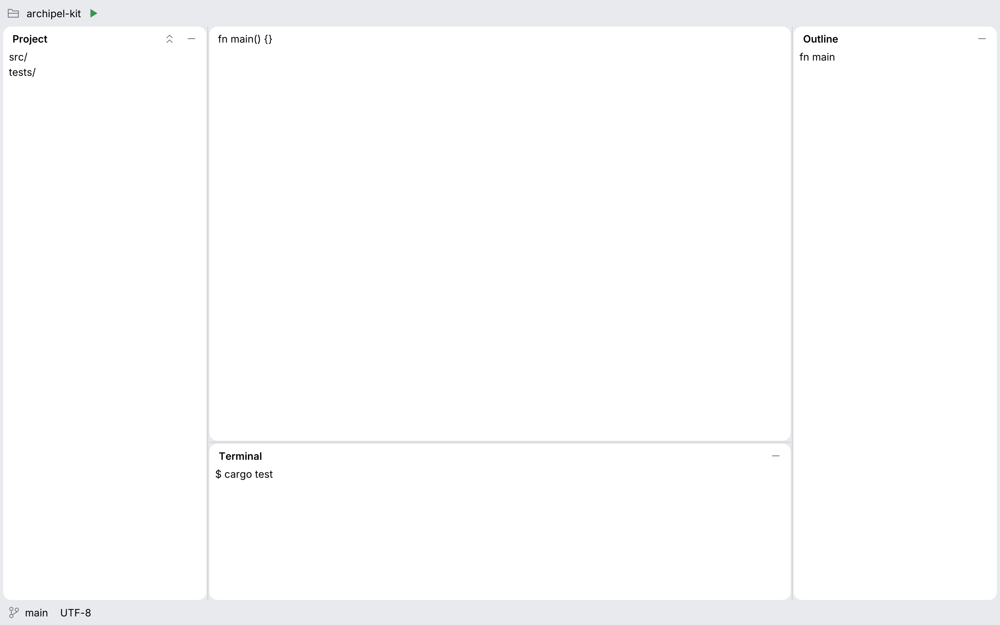
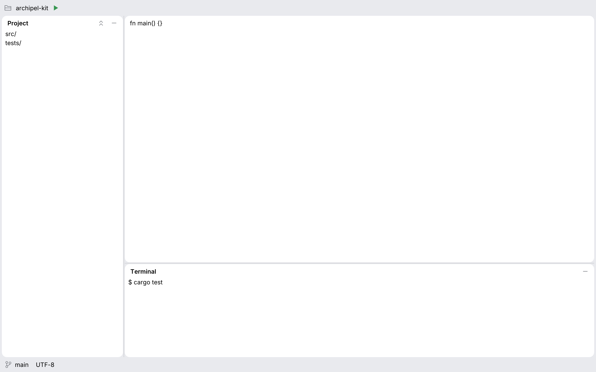

# Workbench

The one islands layout every Archipel app uses for its window: the window frame color
behind everything, a main toolbar and a status bar on the frame, and left, right and bottom
tool windows and a center as islands, `ISLAND_GAP` (4 points) apart and around the edge,
with the island radius.

<picture>
  <source media="(prefers-color-scheme: dark)" srcset="img/workbench_four_islands.dark.png">
  
</picture>

Three islands (left, center, bottom):

<picture>
  <source media="(prefers-color-scheme: dark)" srcset="img/workbench_three_islands.dark.png">
  
</picture>

## Why one layout

The apps of the suite used to build their own shells: one painted its own islands with a
2 point gap and its own palette, another kept its own splitters. Each was close to the
kit's look and none was the same, so the tools did not look like one suite. `Workbench`
draws the frame, the islands, the gaps, the radius and every divider (a collapsible
[`SplitPane`](split-pane.md)) itself, with [`Panel`](panel.md) as the tool window island.
An app that lays out its window with it cannot get the gap, the radius or the colors
wrong, because it never paints them.

## Usage

The caller owns a `WorkbenchState` (sizes and collapsed flags) and keeps it between frames,
usually in its settings. Give `show` all the space of the window, in a `CentralPanel` with
no frame.

```rust
use archipel_kit::components::{Anchor, StatusBarItem, Workbench, WorkbenchState};
use archipel_kit::egui;

fn window(ctx: &egui::Context, state: &mut WorkbenchState) {
    egui::CentralPanel::default()
        .frame(egui::Frame::NONE)
        .show(ctx, |ui| {
            let out = Workbench::new("window", state)
                .toolbar(|ui| { ui.label("my-project"); })
                .left("Project", |ui| { ui.label("src/"); })
                .actions(Anchor::Left, |ui| { ui.label("…"); })
                .right("Outline", |ui| { ui.label("fn main"); })
                .bottom("Terminal", |ui| { ui.label("$ cargo run"); })
                .status_bar(|ui| { ui.add(StatusBarItem::new("main")); })
                .show(ui, |ui| { ui.label("fn main() {}"); });
            if out.hide_clicked(Anchor::Bottom) {
                // e.g. move the focus back to the editor
            }
            if out.state_changed() {
                // save `state`
            }
        });
}
```

With the `serde` feature `WorkbenchState` is `Serialize` and `Deserialize` (fields missing
in an older file take their defaults):

```rust
use archipel_kit::components::WorkbenchState;

let state = WorkbenchState::default();
let json = serde_json::to_string(&state).unwrap();
assert_eq!(serde_json::from_str::<WorkbenchState>(&json).unwrap(), state);
```

## API

| Builder | Effect |
|---|---|
| `Workbench::new(id, &mut WorkbenchState)` | A workbench; the state is the caller's. |
| `.toolbar(\|ui\| …)` | The main toolbar on the frame, laid out left to right. |
| `.status_bar(\|ui\| …)` | The status bar on the frame; fill it with `StatusBarItem`s. |
| `.left(title, \|ui\| …)`, `.right(…)`, `.bottom(…)` | A tool window: a `Panel` with title and hide button. |
| `.actions(Anchor, \|ui\| …)` | Title bar buttons of that tool window (`Panel::actions`). |
| `.enabled(bool)` | A locked layout has dividers that ignore pointer and keyboard. |
| `.show(ui, \|ui\| …)` | Draws everything; the closure fills the center island. |

`WorkbenchState` has `left`, `right` (widths) and `bottom` (height) in points, the three
`*_collapsed` flags, and `is_collapsed`, `set_collapsed` and `toggle` by `Anchor` for toolbar
buttons and shortcuts. It is `#[non_exhaustive]`: start from `Default`.

`show` returns a `WorkbenchResponse`: `inner` (what the center returned), `hidden` (hide
buttons clicked; already collapsed in the state), `resized` (dividers the user moved,
collapsed or expanded), `dividers` (their responses, for behaviours), and the helpers
`hide_clicked(anchor)`, `resized(anchor)` and `state_changed()`.

## Behavior

- **Regions**: left and right tool windows run the full height between the bars; the
  bottom one sits under the center. A region without a builder call is not drawn and gets
  no divider.
- **Sizes are points**, not shares: a bigger window gives the room to the center, and a
  window resize never writes the state. Tool windows keep at least 160 points wide (96 high
  at the bottom) and the center keeps 200 by 120 where the window allows it.
- **Collapse**: the hide button of a tool window, <kbd>Enter</kbd> or <kbd>Space</kbd> on its
  focused divider, or dragging it far past its minimum collapses it; the divider stays as a
  thin edge to drag it back out, and expanding restores the size from before. The caller
  can also flip the flags (the stripes and toolbar buttons of an app).
- **Dividers** are `SplitPane`s named "Resize <title>": same hit area, cursor, keys and
  collapse rules as everywhere else. In <kbd>Tab</kbd> order the left one comes first.
- **Center**: an island without padding, clipped to its rounded rectangle, so editors run
  to the edge. Put banners inside it; nest `SplitPane`s in it for editor groups.
- **Bars**: 26 and 24 points high, on the frame, with `TOOLBAR_GAP` between items.

## Accessibility

Every divider is a `Splitter` named "Resize <title>" with its value and expanded state; the
hide button is "Hide <title>". The audit of 3- and 4-island layouts, dark and light, finds no
overlaps and everything reachable by <kbd>Tab</kbd>.

Source: [`components/workbench.rs`](../../crates/archipel-kit/src/components/workbench.rs) ·
Tests: [`tests/workbench.rs`](../../crates/archipel-kit/tests/workbench.rs)
