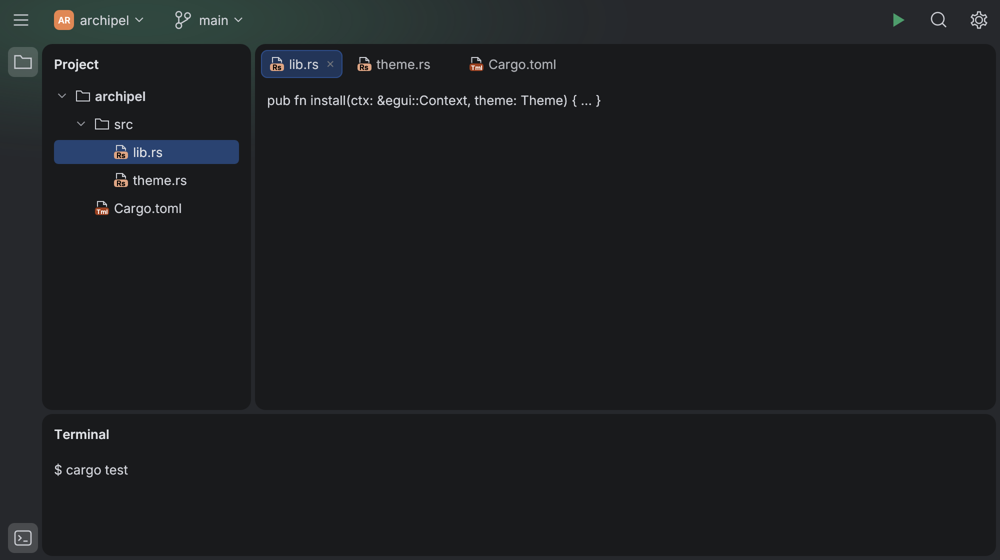
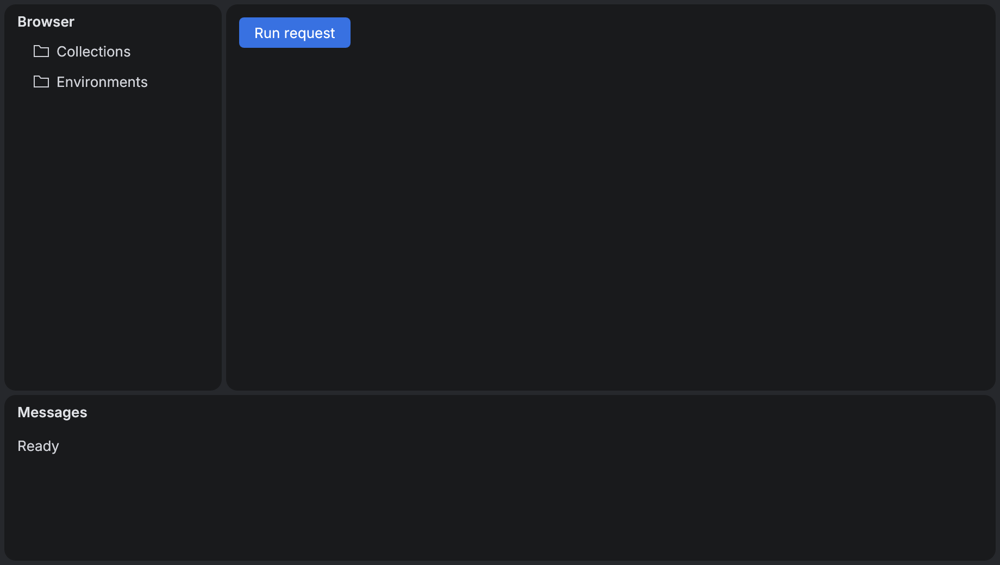
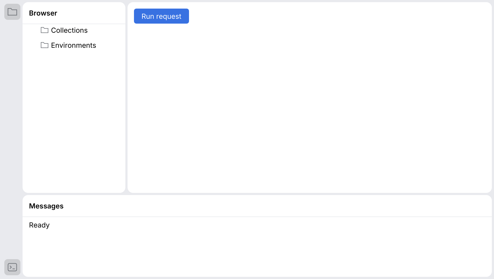
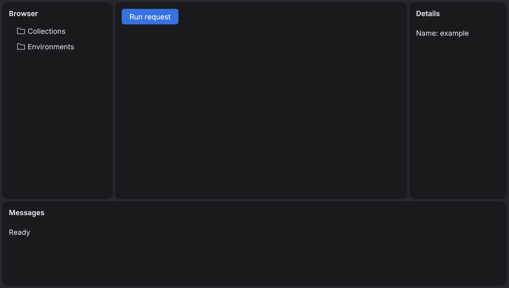
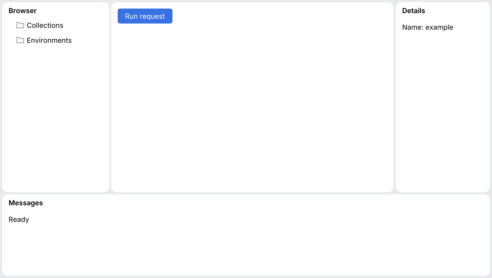

# Workbench

`Workbench` assembles a center island and optional left, right and bottom tool windows.
All gutters and splitters use the kit tokens. Its optional toolbar uses `WindowToolbar`;
the optional status area stays on the themed frame. Applications supply the content.

```rust
use archipel_kit::components::{
    StatusBarItem, WindowChrome, Workbench, WorkbenchRegion, WorkbenchState,
};
use archipel_kit::Glyph;
let mut state = WorkbenchState::default();
# egui::__run_test_ctx(|ctx| {
Workbench::new("workspace", &mut state)
    .toolbar(WindowChrome::Integrated, |ui| { ui.label("My application"); })
    .left("Browser", |ui| { ui.label("Collections"); })
    .right("Details", |ui| { ui.label("Properties"); })
    .padded(WorkbenchRegion::Right, true)
    .bottom("Messages", |ui| { ui.label("Ready"); })
    .padded(WorkbenchRegion::Bottom, true)
    .icon(WorkbenchRegion::Bottom, Glyph::Terminal)
    .status(|ui| { ui.add(StatusBarItem::new("UTF-8")); })
    .show(ctx, |ui| { ui.label("Document"); });
# });
```

`WorkbenchRegion` identifies the left, right or bottom maximized tool window.

## One closure for the whole window

An application usually has one state that every region reads and writes. Declare the
places and fill them from one closure, so the state is borrowed once:

```rust
use archipel_kit::components::{
    StatusBarItem, WindowChrome, Workbench, WorkbenchPlace, WorkbenchRegion, WorkbenchState,
};
use archipel_kit::{Glyph, egui};

struct App { layout: WorkbenchState, sent: u32 }

fn window(ctx: &egui::Context, app: &mut App) {
    let App { layout, sent } = app;
    Workbench::new("nexus", layout)
        .with_toolbar(WindowChrome::Integrated)
        .tool(WorkbenchRegion::Left, "Collections", Glyph::Folder)
        .tool(WorkbenchRegion::Right, "Response", Glyph::Structure)
        .with_status()
        .show_with(ctx, sent, |place, ui, sent| match place {
            WorkbenchPlace::Center => { /* request editor */ }
            WorkbenchPlace::Status => { ui.add(StatusBarItem::new(format!("{sent} sent"))); }
            _ => {}
        });
}
```

`WorkbenchPlace` is `Center`, `Tool(region)`, `Toolbar` or `Status`.

## Islands behavior

As in the IntelliJ / Android Studio Islands UI:

- **Gaps are the dividers.** The 4 pt frame-colored gap between islands has no line; the
  pointer shows the resize cursor over it (`SplitPane::line(false)`). Tab still reaches each
  divider, which then shows the focus ring.
- **Header actions appear on hover.** A tool window's Maximize/Restore and Hide buttons
  show at once while the pointer is anywhere over that island, header or body, or focus is
  inside it, and fade out 200 ms after it leaves (timing and narrow-island rules: see
  [Panel](panel.md#composable-island-headers)). Hidden, they keep their names and Tab order.
- **Tool window stripes.** `.icon(region, glyph)` puts the region's button on a stripe on
  the frame: the left stripe holds the left tool window (top group) and the bottom one
  (bottom group), the right stripe the right one. A button is filled while its tool window
  is open; clicking it opens or closes it, so a hidden tool window always has a way back.
  Its tooltip (name, shortcut) appears beside it. Stripes are 38 pt wide with 30 pt buttons
  on a 40 pt pitch and 20 pt icons, so the islands start 42 pt from the window edge, as in
  Android Studio. `ToolStripe` and `StripeButton` are public for other layouts.
- **Bodies are edge to edge** by default, so trees, lists and consoles bring their own row
  inset. `.padded(WorkbenchRegion::Right, true)` gives a form or text body the content inset.


The caller owns `WorkbenchState`, which supports serde serialization independently of
egui. Drag or use the splitter arrow keys to resize; Enter collapses or expands its tool
window. Headers expose named Hide and Maximize/Restore buttons. To reopen a hidden pane,
set its `*_hidden` flag to false from the application's navigation or shortcut.

Small viewports temporarily hide right, then left tool windows to preserve the central
work area. A short viewport hides the bottom pane. Preferred ratios and explicit hidden
flags are retained, so panes return when the window grows. Missing or hidden maximized
panes return to the center. Hidden content callbacks are not invoked.

`show_inside` embeds only the docked islands into a bounded UI area. `show` additionally
supplies the outer gutter, toolbar and status area. Floating windows, tool-window
stripes, multiple tools per region, and SDK/app migration remain separate follow-ups;
this component does not silently store unsupported layout modes.

## A whole window

`workbench_ide` is built only from kit components, laid out like Android Studio: a toolbar
with the main menu, a project widget (`ToolbarButton` + `Avatar`) and the project color's
glow, stripes, a project tree, an editor island with `TabBar` (`.center_padded(false)` keeps
the tabs at the island's top) and a terminal.








