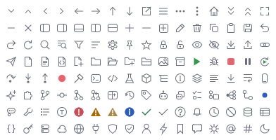

# Archipel Icons

A designed icon set for developer tools: 128 outline glyphs on a 16×16 grid, in nine
categories, from chevrons to databases, and 78 language icons, one for every common
programming language and file format. Icons are **data**, not pictures. The same
definitions render crisply in egui at any size and export as SVG for websites, docs and
design tools.

<picture>
  <source media="(prefers-color-scheme: dark)" srcset="img/actual-size.dark.png">
  
</picture>

*Every glyph at 16 px, 1×: the size it is used at.*

- [Catalog](catalog.md): every glyph by category, with names and keywords.
- [Language icons](languages.md): 78 languages and file formats, with their extensions.
- [Symbol icons](symbols.md): classes, interfaces, methods, fields and their modifiers.
- [Agent icons](agents.md): which glyph stands for each concept of an agent session and its transcript.
- [Design rules](design.md): the grid, strokes and shapes every glyph follows.
- [Review](review.md): how glyphs are reviewed, and the review log.
- [`svg/`](svg/): one SVG per glyph (`currentColor`).

## Usage

In an Archipel Kit app, glyphs work wherever an icon is expected:

```rust
use archipel_kit::{ui::Button, action_system::ActionButton};
use archipel_kit::{Glyph, egui};

fn toolbar(ui: &mut egui::Ui) {
    ui.add(ActionButton::new(Glyph::Refresh, "Reload"));
    ui.add(Button::secondary("Connect").icon(Glyph::Plug));
}
```

Standalone, with plain egui (feature `egui`) or as SVG:

```rust
use archipel_icons::{Glyph, Tones};

// Find glyphs by name or keyword, e.g. for an icon picker.
let found: Vec<Glyph> = Glyph::search("http").collect();
assert!(found.contains(&Glyph::Globe));

// SVG with `currentColor` ink, for the web.
let svg = Glyph::Database.to_svg(24.0, &Tones { ink: 0, ..Tones::dark() });
assert!(svg.contains("currentColor"));
```

```toml
[dependencies]
archipel-icons = { git = "https://github.com/archipel-dev/kit", features = ["egui"] }
```

## Language icons

Every language gets the same kind of icon: a file outline in the ink color with a band in
its GitHub Linguist color carrying a short label (`Rs`, `Py`, `C#`, `{}`). Labels are set in
the app's bold UI font (Inter SemiBold in Archipel Kit) and centered on their ink, white or
black, whichever contrasts more with the band (at least 4.5:1). Bands too dark for dark
themes or too light for light themes get a soft outline.

```rust
use archipel_icons::Language;

assert_eq!(Language::from_file_name("build.gradle.kts"), Some(Language::GradleKotlin));
assert_eq!(Language::from_file_name("Dockerfile"), Some(Language::Dockerfile));
assert_eq!(Language::Rust.label(), "Rs");
```

In Archipel Kit, `Icon::for_file(name)` returns the language icon (or a Java type circle,
image, archive or text page).

## Symbol icons

Code symbols for structure views, completion and outlines: types are circles with a capital
(`C` class, `I` interface, `E` enum, `R` record, `@` annotation, `S` struct, `T` trait, `O`
object), members rounded squares with a small letter (`m` method, `f` field, `p` property,
`c` constructor, `ƒ` function, `λ` lambda …). Modifiers are overlays: abstract (hollow),
static (dot) and visibility (private square, protected diamond, internal ring). Every color
gives white labels 4.5:1 and the shape 3:1 on dark and light.

```rust
use archipel_icons::{Symbol, SymbolKind, Visibility};

// From a language server's DocumentSymbol.kind:
let kind = SymbolKind::from_lsp(6).unwrap_or(SymbolKind::Variable);
let icon = Symbol::new(kind).visibility(Visibility::Private).static_(true);
assert_eq!(icon.slug(), "method-private-static");
```

## Tones

Glyphs are drawn in one ink color, the color you pass. Status glyphs carry semantic tones
that renderers map to theme colors: `Error`, `Warning`, `Muted` (weak warning), `Success`,
`Info`, `Run` and `Stop`, plus `Knockout` (the background, for the `!` cut out of a filled
circle). `archipel_kit::icons::tones(&theme)` maps them from an Archipel Kit theme.

## Adding a glyph

1. Sketch it on the 16×16 grid following the [design rules](design.md).
2. Add it to `crates/archipel-icons/src/glyphs.rs` in its category, with a doc comment and
   keywords.
3. `cargo test -p archipel-icons` runs the lints; fix every finding.
4. `REVIEW=1 UPDATE_SNAPSHOTS=1 cargo test -p archipel-icons` renders the catalog, the SVGs
   and large review sheets in `target/icon-review/`. Review the glyph (see
   [review](review.md)) at large size and at actual size, in dark and light.
5. Commit the images, SVGs and catalog with the glyph; reviewers see them in the diff.
