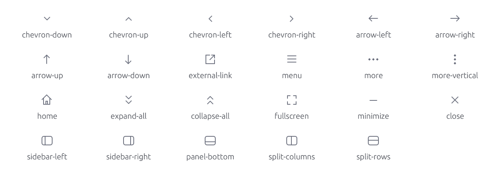
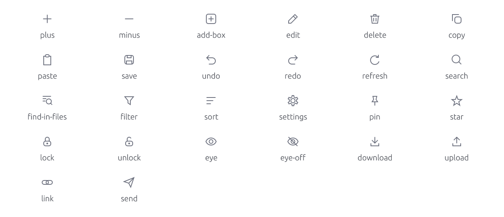
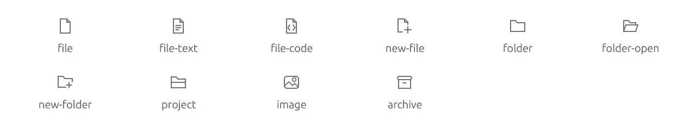
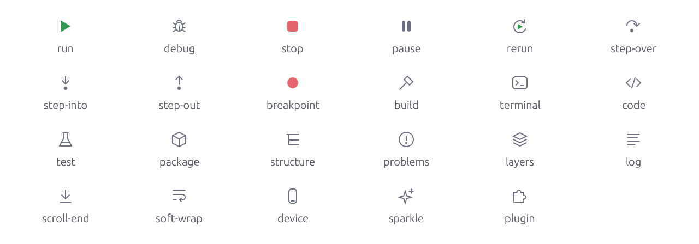
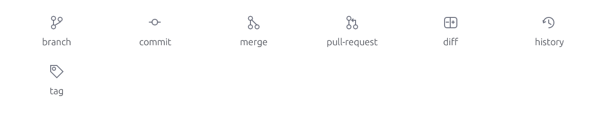
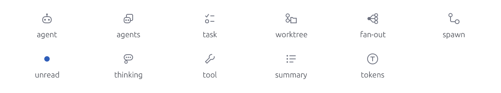
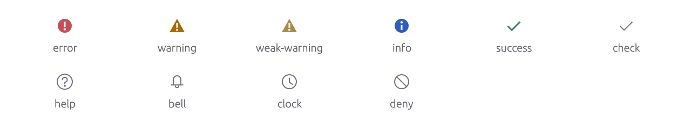
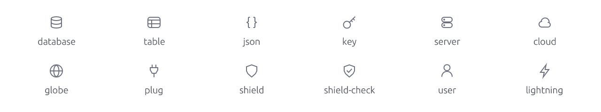

# Icon catalog

<!-- Generated by `crates/archipel-icons/tests/generated.rs`; do not edit. -->

128 glyphs in 9 categories. Every glyph is also an SVG in [`svg/`](svg/) (`currentColor`, 16×16 viewBox). In Rust: `archipel_icons::Glyph::Name`, re-exported as `archipel_kit::Glyph`.

- [Navigation](#navigation)
- [Actions](#actions)
- [Files](#files)
- [Development](#development)
- [Version control](#version-control)
- [Agents](#agents)
- [Status](#status)
- [Data & network](#data--network)
- [General](#general)

## Navigation

<picture>
  <source media="(prefers-color-scheme: dark)" srcset="img/navigation.dark.png">
  
</picture>

| Glyph | Name | Keywords |
|---|---|---|
| `Glyph::ChevronDown` | [`chevron-down`](svg/chevron-down.svg) | expanded, dropdown, open |
| `Glyph::ChevronUp` | [`chevron-up`](svg/chevron-up.svg) | collapse, close |
| `Glyph::ChevronLeft` | [`chevron-left`](svg/chevron-left.svg) | back, previous |
| `Glyph::ChevronRight` | [`chevron-right`](svg/chevron-right.svg) | collapsed, next, forward |
| `Glyph::ArrowLeft` | [`arrow-left`](svg/arrow-left.svg) | back |
| `Glyph::ArrowRight` | [`arrow-right`](svg/arrow-right.svg) | forward, next |
| `Glyph::ArrowUp` | [`arrow-up`](svg/arrow-up.svg) | up |
| `Glyph::ArrowDown` | [`arrow-down`](svg/arrow-down.svg) | down |
| `Glyph::ExternalLink` | [`external-link`](svg/external-link.svg) | open, browser, new window |
| `Glyph::Menu` | [`menu`](svg/menu.svg) | hamburger, main menu |
| `Glyph::More` | [`more`](svg/more.svg) | overflow, ellipsis, options |
| `Glyph::MoreVertical` | [`more-vertical`](svg/more-vertical.svg) | overflow, kebab, options |
| `Glyph::Home` | [`home`](svg/home.svg) | welcome, start |
| `Glyph::ExpandAll` | [`expand-all`](svg/expand-all.svg) | unfold, tree |
| `Glyph::CollapseAll` | [`collapse-all`](svg/collapse-all.svg) | fold, tree |
| `Glyph::Fullscreen` | [`fullscreen`](svg/fullscreen.svg) | maximize, expand, zen |
| `Glyph::Minimize` | [`minimize`](svg/minimize.svg) | hide, collapse panel |
| `Glyph::Close` | [`close`](svg/close.svg) | dismiss, remove, x |
| `Glyph::SidebarLeft` | [`sidebar-left`](svg/sidebar-left.svg) | panel, layout, tool window |
| `Glyph::SidebarRight` | [`sidebar-right`](svg/sidebar-right.svg) | panel, layout, inspector |
| `Glyph::PanelBottom` | [`panel-bottom`](svg/panel-bottom.svg) | layout, terminal panel, console |
| `Glyph::SplitColumns` | [`split-columns`](svg/split-columns.svg) | split right, side by side, layout |
| `Glyph::SplitRows` | [`split-rows`](svg/split-rows.svg) | split down, layout |

## Actions

<picture>
  <source media="(prefers-color-scheme: dark)" srcset="img/actions.dark.png">
  
</picture>

| Glyph | Name | Keywords |
|---|---|---|
| `Glyph::Plus` | [`plus`](svg/plus.svg) | add, new, create |
| `Glyph::Minus` | [`minus`](svg/minus.svg) | remove, subtract |
| `Glyph::AddBox` | [`add-box`](svg/add-box.svg) | add, new, plus |
| `Glyph::Edit` | [`edit`](svg/edit.svg) | pencil, rename, write |
| `Glyph::Delete` | [`delete`](svg/delete.svg) | trash, remove, bin |
| `Glyph::Copy` | [`copy`](svg/copy.svg) | duplicate, clipboard |
| `Glyph::Paste` | [`paste`](svg/paste.svg) | clipboard |
| `Glyph::Save` | [`save`](svg/save.svg) | disk, store |
| `Glyph::Undo` | [`undo`](svg/undo.svg) | revert, rollback, back |
| `Glyph::Redo` | [`redo`](svg/redo.svg) | repeat, forward |
| `Glyph::Refresh` | [`refresh`](svg/refresh.svg) | reload, sync, update |
| `Glyph::Search` | [`search`](svg/search.svg) | find, magnifier, lookup |
| `Glyph::FindInFiles` | [`find-in-files`](svg/find-in-files.svg) | search everywhere, grep |
| `Glyph::Filter` | [`filter`](svg/filter.svg) | funnel, narrow |
| `Glyph::Sort` | [`sort`](svg/sort.svg) | order, arrange |
| `Glyph::Settings` | [`settings`](svg/settings.svg) | gear, preferences, options, configure |
| `Glyph::Pin` | [`pin`](svg/pin.svg) | thumbtack, keep, stick |
| `Glyph::Star` | [`star`](svg/star.svg) | favorite, bookmark, rate |
| `Glyph::Lock` | [`lock`](svg/lock.svg) | locked, read-only, secure |
| `Glyph::Unlock` | [`unlock`](svg/unlock.svg) | unlocked, writable |
| `Glyph::Eye` | [`eye`](svg/eye.svg) | show, preview, visible, watch |
| `Glyph::EyeOff` | [`eye-off`](svg/eye-off.svg) | hide, hidden, invisible |
| `Glyph::Download` | [`download`](svg/download.svg) | import, save to disk |
| `Glyph::Upload` | [`upload`](svg/upload.svg) | export, push, publish |
| `Glyph::Link` | [`link`](svg/link.svg) | url, chain, hyperlink |
| `Glyph::Send` | [`send`](svg/send.svg) | submit, paper plane, execute request |

## Files

<picture>
  <source media="(prefers-color-scheme: dark)" srcset="img/files.dark.png">
  
</picture>

| Glyph | Name | Keywords |
|---|---|---|
| `Glyph::File` | [`file`](svg/file.svg) | document, page |
| `Glyph::FileText` | [`file-text`](svg/file-text.svg) | document, text, log file |
| `Glyph::FileCode` | [`file-code`](svg/file-code.svg) | source, code file |
| `Glyph::NewFile` | [`new-file`](svg/new-file.svg) | create file, add file |
| `Glyph::Folder` | [`folder`](svg/folder.svg) | directory |
| `Glyph::FolderOpen` | [`folder-open`](svg/folder-open.svg) | directory, open project |
| `Glyph::NewFolder` | [`new-folder`](svg/new-folder.svg) | create directory |
| `Glyph::Project` | [`project`](svg/project.svg) | workspace, root |
| `Glyph::Image` | [`image`](svg/image.svg) | picture, photo, png |
| `Glyph::Archive` | [`archive`](svg/archive.svg) | zip, jar, compressed, box |

## Development

<picture>
  <source media="(prefers-color-scheme: dark)" srcset="img/development.dark.png">
  
</picture>

| Glyph | Name | Keywords |
|---|---|---|
| `Glyph::Run` | [`run`](svg/run.svg) | play, start, execute |
| `Glyph::Debug` | [`debug`](svg/debug.svg) | bug, debugger |
| `Glyph::Stop` | [`stop`](svg/stop.svg) | terminate, halt |
| `Glyph::Pause` | [`pause`](svg/pause.svg) | suspend, hold |
| `Glyph::Rerun` | [`rerun`](svg/rerun.svg) | restart, run again |
| `Glyph::StepOver` | [`step-over`](svg/step-over.svg) | debugger, next line |
| `Glyph::StepInto` | [`step-into`](svg/step-into.svg) | debugger, enter |
| `Glyph::StepOut` | [`step-out`](svg/step-out.svg) | debugger, return |
| `Glyph::Breakpoint` | [`breakpoint`](svg/breakpoint.svg) | debugger, stop point |
| `Glyph::Build` | [`build`](svg/build.svg) | hammer, compile, make |
| `Glyph::Terminal` | [`terminal`](svg/terminal.svg) | console, shell, command line |
| `Glyph::Code` | [`code`](svg/code.svg) | source, brackets, html |
| `Glyph::Test` | [`test`](svg/test.svg) | flask, experiment, unit test |
| `Glyph::Package` | [`package`](svg/package.svg) | module, dependency, cube, crate, model |
| `Glyph::Structure` | [`structure`](svg/structure.svg) | outline, hierarchy, tree |
| `Glyph::Problems` | [`problems`](svg/problems.svg) | issues, diagnostics, errors |
| `Glyph::Layers` | [`layers`](svg/layers.svg) | variants, environments, stack |
| `Glyph::Log` | [`log`](svg/log.svg) | output, logcat, console output |
| `Glyph::ScrollEnd` | [`scroll-end`](svg/scroll-end.svg) | bottom, follow output |
| `Glyph::SoftWrap` | [`soft-wrap`](svg/soft-wrap.svg) | word wrap, wrap lines |
| `Glyph::Device` | [`device`](svg/device.svg) | phone, mobile, emulator |
| `Glyph::Sparkle` | [`sparkle`](svg/sparkle.svg) | ai, assistant, magic, generate |
| `Glyph::Plugin` | [`plugin`](svg/plugin.svg) | extension, puzzle, add-on |

## Version control

<picture>
  <source media="(prefers-color-scheme: dark)" srcset="img/version-control.dark.png">
  
</picture>

| Glyph | Name | Keywords |
|---|---|---|
| `Glyph::Branch` | [`branch`](svg/branch.svg) | git, fork |
| `Glyph::Commit` | [`commit`](svg/commit.svg) | git, revision, checkin |
| `Glyph::Merge` | [`merge`](svg/merge.svg) | git, join |
| `Glyph::PullRequest` | [`pull-request`](svg/pull-request.svg) | git, merge request, review |
| `Glyph::Diff` | [`diff`](svg/diff.svg) | compare, changes |
| `Glyph::History` | [`history`](svg/history.svg) | recent, log, time |
| `Glyph::Tag` | [`tag`](svg/tag.svg) | release, version, label |

## Agents

<picture>
  <source media="(prefers-color-scheme: dark)" srcset="img/agents.dark.png">
  
</picture>

| Glyph | Name | Keywords |
|---|---|---|
| `Glyph::Agent` | [`agent`](svg/agent.svg) | ai, assistant, worker, bot, robot |
| `Glyph::Agents` | [`agents`](svg/agents.svg) | agents mode, orchestrator, multi-agent, team, swarm |
| `Glyph::Task` | [`task`](svg/task.svg) | todo, to-do, checklist, plan, step |
| `Glyph::Worktree` | [`worktree`](svg/worktree.svg) | git worktree, checkout, workspace, branch folder |
| `Glyph::FanOut` | [`fan-out`](svg/fan-out.svg) | broadcast, parallel, split, dispatch, best of n |
| `Glyph::Spawn` | [`spawn`](svg/spawn.svg) | sub-agent, subagent, child, delegate, launch agent |
| `Glyph::Unread` | [`unread`](svg/unread.svg) | badge, new, dot, notification |
| `Glyph::Thinking` | [`thinking`](svg/thinking.svg) | reasoning, thought, chain of thought, reflect |
| `Glyph::Tool` | [`tool`](svg/tool.svg) | tool call, wrench, function call, utility |
| `Glyph::Summary` | [`summary`](svg/summary.svg) | result, turn result, recap, list, overview |
| `Glyph::Tokens` | [`tokens`](svg/tokens.svg) | cost, usage, context, coin, budget |

## Status

<picture>
  <source media="(prefers-color-scheme: dark)" srcset="img/status.dark.png">
  
</picture>

| Glyph | Name | Keywords |
|---|---|---|
| `Glyph::Error` | [`error`](svg/error.svg) | failure, problem, danger |
| `Glyph::Warning` | [`warning`](svg/warning.svg) | caution, alert |
| `Glyph::WeakWarning` | [`weak-warning`](svg/weak-warning.svg) | hint, suggestion |
| `Glyph::Info` | [`info`](svg/info.svg) | information, about, details |
| `Glyph::Success` | [`success`](svg/success.svg) | ok, done, passed |
| `Glyph::Check` | [`check`](svg/check.svg) | checked, selected, tick |
| `Glyph::Help` | [`help`](svg/help.svg) | question, docs, support |
| `Glyph::Bell` | [`bell`](svg/bell.svg) | notifications, alerts, event log |
| `Glyph::Clock` | [`clock`](svg/clock.svg) | time, duration, pending, timer |
| `Glyph::Deny` | [`deny`](svg/deny.svg) | block, blocked, refuse, reject, forbidden |

## Data & network

<picture>
  <source media="(prefers-color-scheme: dark)" srcset="img/data-network.dark.png">
  
</picture>

| Glyph | Name | Keywords |
|---|---|---|
| `Glyph::Database` | [`database`](svg/database.svg) | db, storage, sql, mongodb |
| `Glyph::Table` | [`table`](svg/table.svg) | grid, collection, spreadsheet, rows |
| `Glyph::Json` | [`json`](svg/json.svg) | braces, object, document |
| `Glyph::Key` | [`key`](svg/key.svg) | credentials, secret, primary key, api key |
| `Glyph::Server` | [`server`](svg/server.svg) | host, machine, backend |
| `Glyph::Cloud` | [`cloud`](svg/cloud.svg) | remote, hosted, online |
| `Glyph::Globe` | [`globe`](svg/globe.svg) | http, web, internet, network, url |
| `Glyph::Plug` | [`plug`](svg/plug.svg) | connect, connection, data source |
| `Glyph::Shield` | [`shield`](svg/shield.svg) | security, auth, authentication, protected |
| `Glyph::ShieldCheck` | [`shield-check`](svg/shield-check.svg) | always allow, trusted, approved, verified, permission granted |
| `Glyph::User` | [`user`](svg/user.svg) | account, person, profile |
| `Glyph::Lightning` | [`lightning`](svg/lightning.svg) | event, trigger, fast, index |

## General

<picture>
  <source media="(prefers-color-scheme: dark)" srcset="img/general.dark.png">
  
</picture>

| Glyph | Name | Keywords |
|---|---|---|
| `Glyph::Bookmark` | [`bookmark`](svg/bookmark.svg) | save for later, mark |
| `Glyph::Comment` | [`comment`](svg/comment.svg) | message, chat, review comment |
| `Glyph::Sun` | [`sun`](svg/sun.svg) | light theme, day, brightness |
| `Glyph::Mention` | [`mention`](svg/mention.svg) | at, @, attachment, attach file, reference |
| `Glyph::Hash` | [`hash`](svg/hash.svg) | issue, #, number, channel, tag issue |
| `Glyph::Moon` | [`moon`](svg/moon.svg) | dark theme, night |
