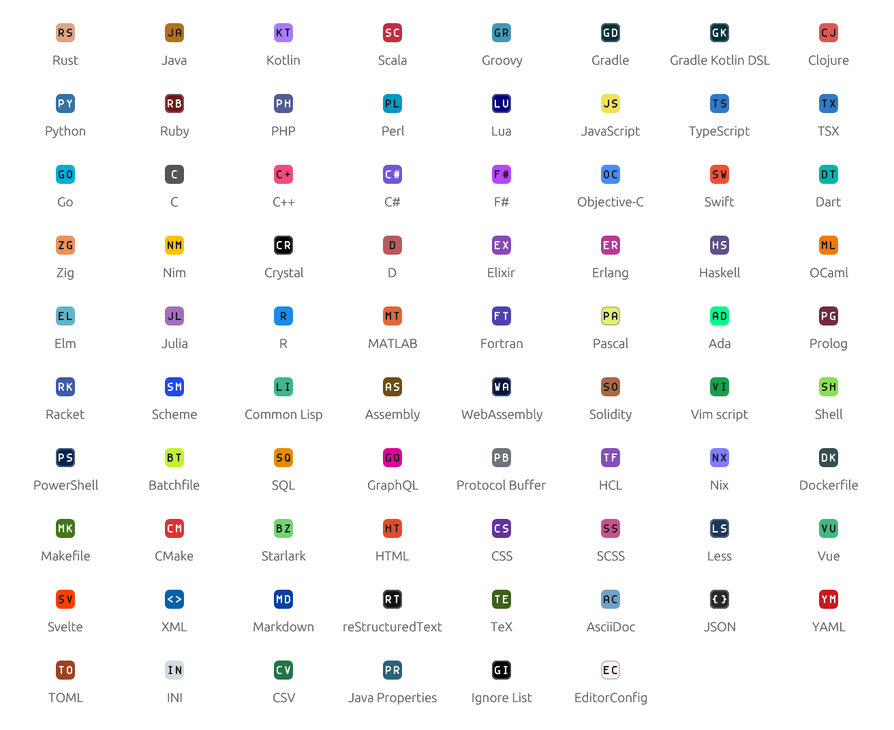
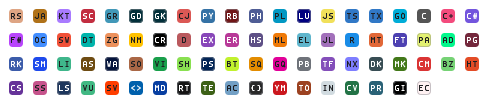

# Language icons

<!-- Generated by `crates/archipel-icons/tests/generated.rs`; do not edit. -->

78 languages and file formats. Each icon is a tile in the language's color (from [GitHub Linguist](https://github.com/github-linguist/linguist), MIT) with a one- or two-letter label in the icon font. `Language::from_file_name` picks one by file name, then by the longest extension. SVGs: `svg/lang-<slug>.svg`.

<picture>
  <source media="(prefers-color-scheme: dark)" srcset="img/languages.dark.png">
  
</picture>

At actual size (16 px, 1×):

<picture>
  <source media="(prefers-color-scheme: dark)" srcset="img/languages-actual-size.dark.png">
  
</picture>

| Language | Label | Color | Extensions | File names |
|---|---|---|---|---|
| [Rust](svg/lang-rust.svg) | `RS` | `#DEA584` | `.rs` `.rs.in` |  |
| [Java](svg/lang-java.svg) | `JA` | `#B07219` | `.java` `.jav` `.jsh` |  |
| [Kotlin](svg/lang-kotlin.svg) | `KT` | `#A97BFF` | `.kt` `.ktm` `.kts` |  |
| [Scala](svg/lang-scala.svg) | `SC` | `#C22D40` | `.scala` `.kojo` `.sbt` `.sc` |  |
| [Groovy](svg/lang-groovy.svg) | `GR` | `#4298B8` | `.groovy` `.grt` `.gtpl` `.gvy` | `Jenkinsfile` |
| [Gradle](svg/lang-gradle.svg) | `GD` | `#02303A` | `.gradle` |  |
| [Gradle Kotlin DSL](svg/lang-gradle-kotlin-dsl.svg) | `GK` | `#02303A` | `.gradle.kts` |  |
| [Clojure](svg/lang-clojure.svg) | `CJ` | `#DB5855` | `.clj` `.bb` `.boot` `.cl2` `.cljc` `.cljs` `.cljs.hl` `.cljscm` `.cljx` `.hic` | `riemann.config` |
| [Python](svg/lang-python.svg) | `PY` | `#3572A5` | `.py` `.cgi` `.fcgi` `.gyp` `.gypi` `.lmi` `.py3` `.pyde` `.pyi` `.pyp` `.pyt` `.pyw` `.rpy` `.spec` `.tac` `.wsgi` `.xpy` | `.gclient` `DEPS` `SConscript` `SConstruct` `wscript` |
| [Ruby](svg/lang-ruby.svg) | `RB` | `#701516` | `.rb` `.builder` `.eye` `.gemspec` `.god` `.jbuilder` `.mspec` `.pluginspec` `.podspec` `.prawn` `.rabl` `.rake` `.rbi` `.rbuild` `.rbw` `.rbx` `.ru` `.ruby` `.thor` `.watchr` | `.irbrc` `.pryrc` `.simplecov` `Appraisals` `Berksfile` `Brewfile` `Buildfile` `Capfile` `Dangerfile` `Deliverfile` `Fastfile` `Gemfile` `Guardfile` `Jarfile` `Mavenfile` `Podfile` `Puppetfile` `Rakefile` `Snapfile` `Steepfile` `Thorfile` `Vagrantfile` `buildfile` |
| [PHP](svg/lang-php.svg) | `PH` | `#4F5D95` | `.php` `.aw` `.ctp` `.inc` `.php3` `.php4` `.php5` `.phps` `.phpt` | `.php` `.php_cs` `.php_cs.dist` `Phakefile` |
| [Perl](svg/lang-perl.svg) | `PL` | `#0298C3` | `.pl` `.al` `.perl` `.ph` `.plx` `.pm` `.psgi` `.t` | `.latexmkrc` `Makefile.PL` `Rexfile` `ack` `cpanfile` `latexmkrc` |
| [Lua](svg/lang-lua.svg) | `LU` | `#000080` | `.lua` `.nse` `.p8` `.pd_lua` `.rbxs` `.rockspec` `.wlua` | `.luacheckrc` |
| [JavaScript](svg/lang-javascript.svg) | `JS` | `#F1E05A` | `.js` `._js` `.bones` `.cjs` `.es` `.es6` `.frag` `.gs` `.jake` `.javascript` `.jsb` `.jscad` `.jsfl` `.jslib` `.jsm` `.jspre` `.jss` `.jsx` `.mjs` `.njs` `.pac` `.sjs` `.ssjs` `.xsjs` `.xsjslib` | `Jakefile` |
| [TypeScript](svg/lang-typescript.svg) | `TS` | `#3178C6` | `.ts` `.cts` `.mts` |  |
| [TSX](svg/lang-tsx.svg) | `TX` | `#3178C6` | `.tsx` |  |
| [Go](svg/lang-go.svg) | `GO` | `#00ADD8` | `.go` |  |
| [C](svg/lang-c.svg) | `C` | `#555555` | `.c` `.cats` `.h` `.h.in` `.idc` |  |
| [C++](svg/lang-cplusplus.svg) | `C+` | `#F34B7D` | `.cpp` `.c++` `.cc` `.cp` `.cppm` `.cxx` `.h++` `.hh` `.hpp` `.hxx` `.inl` `.ino` `.ipp` `.ixx` `.re` `.tcc` `.tpp` `.txx` |  |
| [C#](svg/lang-c-sharp.svg) | `C#` | `#7355DD` | `.cs` `.cake` `.cs.pp` `.csx` `.linq` |  |
| [F#](svg/lang-f-sharp.svg) | `F#` | `#B845FC` | `.fs` `.fsi` `.fsx` |  |
| [Objective-C](svg/lang-objective-c.svg) | `OC` | `#438EFF` | `.m` |  |
| [Swift](svg/lang-swift.svg) | `SW` | `#F05138` | `.swift` |  |
| [Dart](svg/lang-dart.svg) | `DT` | `#00B4AB` | `.dart` |  |
| [Zig](svg/lang-zig.svg) | `ZG` | `#EC915C` | `.zig` `.zig.zon` |  |
| [Nim](svg/lang-nim.svg) | `NM` | `#FFC200` | `.nim` `.nim.cfg` `.nimble` `.nimrod` `.nims` | `nim.cfg` |
| [Crystal](svg/lang-crystal.svg) | `CR` | `#000100` | `.cr` |  |
| [D](svg/lang-d.svg) | `D` | `#BA595E` | `.d` `.di` |  |
| [Elixir](svg/lang-elixir.svg) | `EX` | `#8847B9` | `.ex` `.exs` | `mix.lock` |
| [Erlang](svg/lang-erlang.svg) | `ER` | `#B83998` | `.erl` `.app` `.app.src` `.escript` `.hrl` `.xrl` `.yrl` | `Emakefile` `rebar.config` `rebar.config.lock` `rebar.lock` |
| [Haskell](svg/lang-haskell.svg) | `HS` | `#5E5086` | `.hs` `.hs-boot` `.hsc` |  |
| [OCaml](svg/lang-ocaml.svg) | `ML` | `#EF7A08` | `.ml` `.eliom` `.eliomi` `.ml4` `.mli` `.mll` `.mly` |  |
| [Elm](svg/lang-elm.svg) | `EL` | `#60B5CC` | `.elm` |  |
| [Julia](svg/lang-julia.svg) | `JL` | `#A270BA` | `.jl` |  |
| [R](svg/lang-r.svg) | `R` | `#198CE7` | `.r` `.rd` `.rhistory` `.rsx` | `.Rapp.history` `.Rhistory` `.Rprofile` `expr-dist` |
| [MATLAB](svg/lang-matlab.svg) | `MT` | `#E16737` | `.matlab` |  |
| [Fortran](svg/lang-fortran.svg) | `FT` | `#4D41B1` | `.f` `.f77` `.for` `.fpp` |  |
| [Pascal](svg/lang-pascal.svg) | `PA` | `#E3F171` | `.pas` `.dfm` `.dpr` `.lpr` `.pascal` `.pp` |  |
| [Ada](svg/lang-ada.svg) | `AD` | `#02F88C` | `.adb` `.ada` `.ads` |  |
| [Prolog](svg/lang-prolog.svg) | `PG` | `#74283C` | `.plt` `.pro` `.prolog` `.yap` |  |
| [Racket](svg/lang-racket.svg) | `RK` | `#3C5CAA` | `.rkt` `.rktd` `.rktl` `.scrbl` |  |
| [Scheme](svg/lang-scheme.svg) | `SM` | `#1E4AEC` | `.scm` `.sch` `.sld` `.sls` `.sps` `.ss` |  |
| [Common Lisp](svg/lang-common-lisp.svg) | `LI` | `#3FB68B` | `.lisp` `.asd` `.cl` `.l` `.lsp` `.ny` `.podsl` `.sexp` |  |
| [Assembly](svg/lang-assembly.svg) | `AS` | `#6E4C13` | `.asm` `.a51` `.i` `.nas` `.nasm` `.s` |  |
| [WebAssembly](svg/lang-webassembly.svg) | `WA` | `#04133B` | `.wast` `.wat` |  |
| [Solidity](svg/lang-solidity.svg) | `SO` | `#AA6746` | `.sol` |  |
| [Vim script](svg/lang-vim-script.svg) | `VI` | `#199F4B` | `.vim` `.vba` `.vimrc` `.vmb` | `.exrc` `.gvimrc` `.nvimrc` `.vimrc` `_vimrc` `gvimrc` `nvimrc` `vimrc` |
| [Shell](svg/lang-shell.svg) | `SH` | `#89E051` | `.sh` `.bash` `.bats` `.command` `.ksh` `.pacscript` `.sbatch` `.sh.in` `.slurm` `.tmux` `.tool` `.trigger` `.zsh` `.zsh-theme` | `.bash_aliases` `.bash_functions` `.bash_history` `.bash_logout` `.bash_profile` `.bashrc` `.cshrc` `.envrc` `.flaskenv` `.kshrc` `.login` `.profile` `.tmux.conf` `.xinitrc` `.xsession` `.zlogin` `.zlogout` `.zprofile` `.zshenv` `.zshrc` `9fs` `PKGBUILD` `bash_aliases` `bash_logout` `bash_profile` `bashrc` `cshrc` `gradlew` `kshrc` `login` `man` `mvnw` `profile` `tmux.conf` `xinitrc` `xsession` `zlogin` `zlogout` `zprofile` `zshenv` `zshrc` |
| [PowerShell](svg/lang-powershell.svg) | `PS` | `#012456` | `.ps1` `.psd1` `.psm1` |  |
| [Batchfile](svg/lang-batchfile.svg) | `BT` | `#C1F12E` | `.bat` `.cmd` | `gradlew.bat` `mvnw.cmd` |
| [SQL](svg/lang-sql.svg) | `SQ` | `#E38C00` | `.sql` `.ddl` `.mysql` `.prc` `.tab` `.udf` `.viw` |  |
| [GraphQL](svg/lang-graphql.svg) | `GQ` | `#E10098` | `.graphql` `.gql` `.graphqls` |  |
| [Protocol Buffer](svg/lang-protocol-buffer.svg) | `PB` | `#6F737A` | `.proto` |  |
| [HCL](svg/lang-hcl.svg) | `TF` | `#844FBA` | `.hcl` `.nomad` `.tf` `.tfvars` `.tofu` `.workflow` |  |
| [Nix](svg/lang-nix.svg) | `NX` | `#7E7EFF` | `.nix` |  |
| [Dockerfile](svg/lang-dockerfile.svg) | `DK` | `#384D54` | `.dockerfile` `.containerfile` | `Containerfile` `Dockerfile` |
| [Makefile](svg/lang-makefile.svg) | `MK` | `#427819` | `.mak` `.make` `.makefile` `.mk` `.mkfile` | `BSDmakefile` `GNUmakefile` `Kbuild` `Makefile` `Makefile.am` `Makefile.boot` `Makefile.frag` `Makefile.in` `Makefile.inc` `Makefile.pc` `Makefile.wat` `makefile` `makefile.sco` `mkfile` |
| [CMake](svg/lang-cmake.svg) | `CM` | `#DA3434` | `.cmake` `.cmake.in` | `CMakeLists.txt` |
| [Starlark](svg/lang-starlark.svg) | `BZ` | `#76D275` | `.bzl` `.star` | `BUCK` `BUILD` `BUILD.bazel` `MODULE.bazel` `Tiltfile` `WORKSPACE` `WORKSPACE.bazel` `WORKSPACE.bzlmod` |
| [HTML](svg/lang-html.svg) | `HT` | `#E34C26` | `.html` `.hta` `.htm` `.html.hl` `.xht` `.xhtml` |  |
| [CSS](svg/lang-css.svg) | `CS` | `#663399` | `.css` |  |
| [SCSS](svg/lang-scss.svg) | `SS` | `#C6538C` | `.scss` |  |
| [Less](svg/lang-less.svg) | `LS` | `#1D365D` | `.less` |  |
| [Vue](svg/lang-vue.svg) | `VU` | `#41B883` | `.vue` |  |
| [Svelte](svg/lang-svelte.svg) | `SV` | `#FF3E00` | `.svelte` |  |
| [XML](svg/lang-xml.svg) | `<>` | `#0060AC` | `.xml` `.adml` `.admx` `.ant` `.axaml` `.axml` `.builds` `.ccproj` `.ccxml` `.clixml` `.cproject` `.cscfg` `.csdef` `.csl` `.csproj` `.ct` `.depproj` `.dita` `.ditamap` `.ditaval` `.dll.config` `.dotsettings` `.filters` `.fsproj` `.fxml` `.glade` `.gml` `.gmx` `.gpx` `.grxml` `.gst` `.hzp` `.icls` `.iml` `.ivy` `.jelly` `.jsproj` `.kml` `.launch` `.mdpolicy` `.meta4` `.mjml` `.mm` `.mod` `.mojo` `.mxml` `.natvis` `.ncl` `.ndproj` `.nproj` `.nuspec` `.odd` `.osm` `.pkgproj` `.proj` `.props` `.ps1xml` `.psc1` `.pt` `.pubxml` `.qhelp` `.rbxmx` `.rdf` `.res` `.resx` `.rss` `.scxml` `.sfproj` `.shproj` `.slnx` `.srdf` `.storyboard` `.sublime-snippet` `.sw` `.targets` `.tml` `.typ` `.ui` `.urdf` `.ux` `.vbproj` `.vcxproj` `.vsixmanifest` `.vssettings` `.vstemplate` `.vxml` `.wixproj` `.wsdl` `.wsf` `.wxi` `.wxl` `.wxs` `.x3d` `.xacro` `.xaml` `.xib` `.xlf` `.xliff` `.xmi` `.xml.dist` `.xmp` `.xproj` `.xsd` `.xspec` `.xul` `.zcml` | `.classpath` `.cproject` `.project` `App.config` `NuGet.config` `Settings.StyleCop` `Web.Debug.config` `Web.Release.config` `Web.config` `packages.config` |
| [Markdown](svg/lang-markdown.svg) | `MD` | `#083FA1` | `.md` `.livemd` `.markdown` `.mdown` `.mdwn` `.mkd` `.mkdn` `.mkdown` `.ronn` `.scd` `.workbook` | `contents.lr` |
| [reStructuredText](svg/lang-restructuredtext.svg) | `RT` | `#141414` | `.rst` `.rest` `.rest.txt` `.rst.txt` |  |
| [TeX](svg/lang-tex.svg) | `TE` | `#3D6117` | `.tex` `.aux` `.bbx` `.cbx` `.cls` `.dtx` `.ins` `.lbx` `.ltx` `.mkii` `.mkiv` `.mkvi` `.sty` `.toc` |  |
| [AsciiDoc](svg/lang-asciidoc.svg) | `AC` | `#73A0C5` | `.asciidoc` `.adoc` `.asc` |  |
| [JSON](svg/lang-json.svg) | `{}` | `#292929` | `.json` `.4dform` `.4dproject` `.avsc` `.geojson` `.gltf` `.har` `.ice` `.json-tmlanguage` `.json.example` `.jsonl` `.mcmeta` `.sarif` `.slnlaunch` `.tact` `.tfstate` `.tfstate.backup` `.topojson` `.webapp` `.webmanifest` `.yy` `.yyp` | `.all-contributorsrc` `.arcconfig` `.auto-changelog` `.c8rc` `.htmlhintrc` `.imgbotconfig` `.nycrc` `.releaserc` `.secrets.baseline` `.tern-config` `.tern-project` `.watchmanconfig` `MODULE.bazel.lock` `Package.resolved` `Pipfile.lock` `bun.lock` `composer.lock` `deno.lock` `flake.lock` `mcmod.info` |
| [YAML](svg/lang-yaml.svg) | `YM` | `#CB171E` | `.yml` `.mir` `.reek` `.rviz` `.sublime-syntax` `.syntax` `.yaml` `.yaml-tmlanguage` `.yaml.sed` `.yml.mysql` | `.clang-format` `.clang-tidy` `.clangd` `.eslintrc` `.gemrc` `CITATION.cff` `glide.lock` `pixi.lock` `yarn.lock` |
| [TOML](svg/lang-toml.svg) | `TO` | `#9C4221` | `.toml` `.toml.example` | `Cargo.lock` `Cargo.toml.orig` `Gopkg.lock` `Pipfile` `mise.local.lock` `mise.lock` `pdm.lock` `poetry.lock` `uv.lock` |
| [INI](svg/lang-ini.svg) | `IN` | `#D1DBE0` | `.ini` `.cfg` `.cnf` `.container` `.dof` `.frm` `.lektorproject` `.mount` `.network` `.prefs` `.properties` `.service` `.socket` `.target` `.timer` `.url` | `.buckconfig` `.coveragerc` `.flake8` `.gitreview` `.pylintrc` `HOSTS` `buildozer.spec` `hosts` `pylintrc` `vlcrc` |
| [CSV](svg/lang-csv.svg) | `CV` | `#237346` | `.csv` |  |
| [Java Properties](svg/lang-java-properties.svg) | `PR` | `#2A6277` |  |  |
| [Ignore List](svg/lang-ignore-list.svg) | `GI` | `#000000` | `.gitignore` | `.agignore` `.atomignore` `.babelignore` `.bzrignore` `.ckignore` `.coffeelintignore` `.cvsignore` `.dockerignore` `.easignore` `.eleventyignore` `.eslint-ignore` `.eslintignore` `.gitignore` `.ignore` `.markdownlintignore` `.nodemonignore` `.npmignore` `.prettierignore` `.rgignore` `.stylelintignore` `.vercelignore` `.vscodeignore` `gitignore-global` `gitignore_global` |
| [EditorConfig](svg/lang-editorconfig.svg) | `EC` | `#FFF1F2` | `.editorconfig` | `.editorconfig` |
