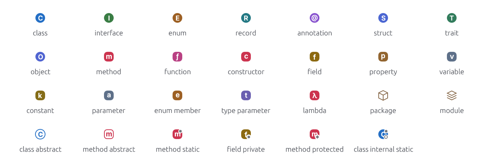

# Symbol icons

<!-- Generated by `crates/archipel-icons/tests/generated.rs`; do not edit. -->

Code symbols for structure views, completion, outlines and search. The shape says what a symbol is (circle: type, rounded square: member, glyph: namespace), the letter which one, the color its group. Modifiers are overlays: **abstract** draws the shape hollow, **static** adds a dot at the top right, and visibility adds a mark at the bottom right: a square for **private**, a diamond for **protected**, a ring for **internal** (package-private); public has no mark. SVGs: `svg/sym-<kind>.svg`.

<picture>
  <source media="(prefers-color-scheme: dark)" srcset="img/symbols.dark.png">
  
</picture>

At actual size (16 px, 1×):

<picture>
  <source media="(prefers-color-scheme: dark)" srcset="img/symbols-actual-size.dark.png">
  
</picture>

| Kind | Shape | Label | Color | LSP `SymbolKind` |
|---|---|---|---|---|
| [Class](svg/sym-class.svg) | Type | `C` | `#246FC5` | 5 |
| [Interface](svg/sym-interface.svg) | Type | `I` | `#3A7D45` | 11 |
| [Enum](svg/sym-enum.svg) | Type | `E` | `#9D6024` | 10 |
| [Record](svg/sym-record.svg) | Type | `R` | `#247984` |  |
| [Annotation](svg/sym-annotation.svg) | Type | `@` | `#8853CE` |  |
| [Struct](svg/sym-struct.svg) | Type | `S` | `#4B66D2` | 23 |
| [Trait](svg/sym-trait.svg) | Type | `T` | `#327C5C` |  |
| [Object](svg/sym-object.svg) | Type | `O` | `#5165D1` | 19 |
| [Method](svg/sym-method.svg) | Member | `m` | `#CC344F` | 6, 25 |
| [Function](svg/sym-function.svg) | Member | `ƒ` | `#B94183` | 12, 24 |
| [Constructor](svg/sym-constructor.svg) | Member | `c` | `#CC344F` | 9 |
| [Field](svg/sym-field.svg) | Member | `f` | `#8C6911` | 8 |
| [Property](svg/sym-property.svg) | Member | `p` | `#926530` | 7 |
| [Variable](svg/sym-variable.svg) | Member | `v` | `#5E7089` | 13 |
| [Constant](svg/sym-constant.svg) | Member | `k` | `#856D18` | 14 |
| [Parameter](svg/sym-parameter.svg) | Member | `a` | `#5E7089` |  |
| [Enum member](svg/sym-enum-member.svg) | Member | `e` | `#9D6024` | 22 |
| [Type parameter](svg/sym-type-parameter.svg) | Member | `t` | `#6A5FB0` | 26 |
| [Lambda](svg/sym-lambda.svg) | Member | `λ` | `#CC344F` |  |
| [Package](svg/sym-package.svg) | Namespace | `` | `#87694A` | 4 |
| [Module](svg/sym-module.svg) | Namespace | `` | `#87694A` | 2, 3 |
