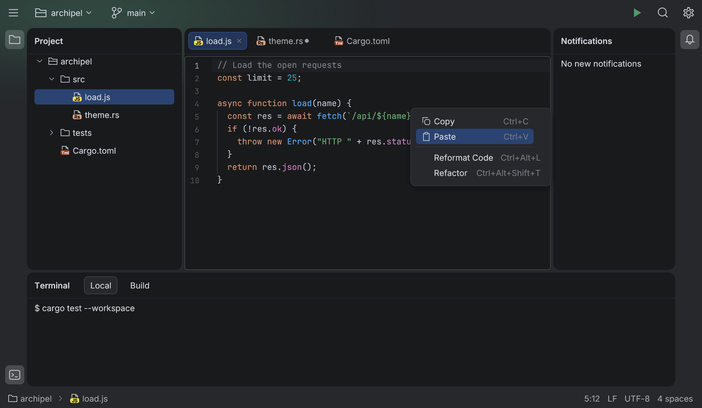
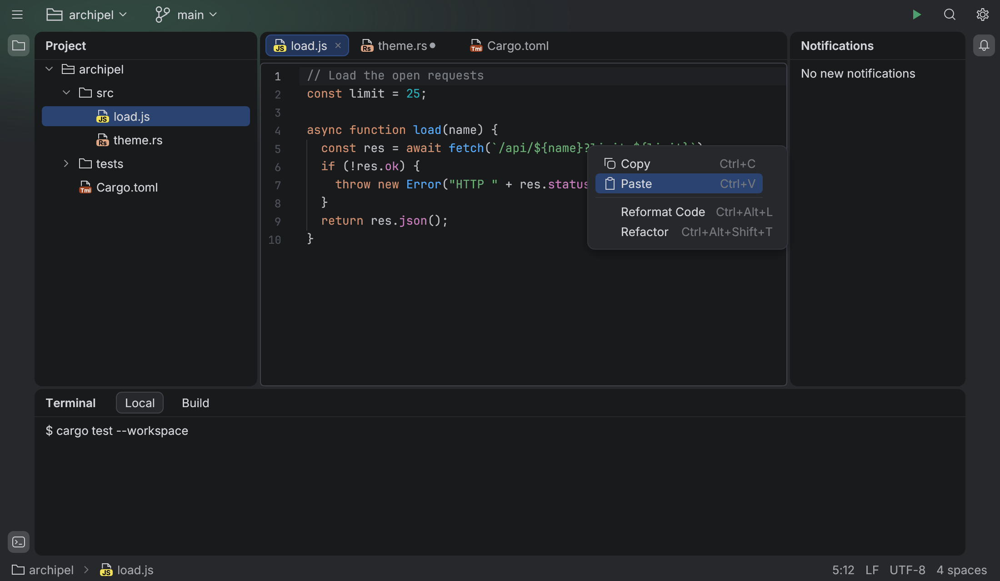
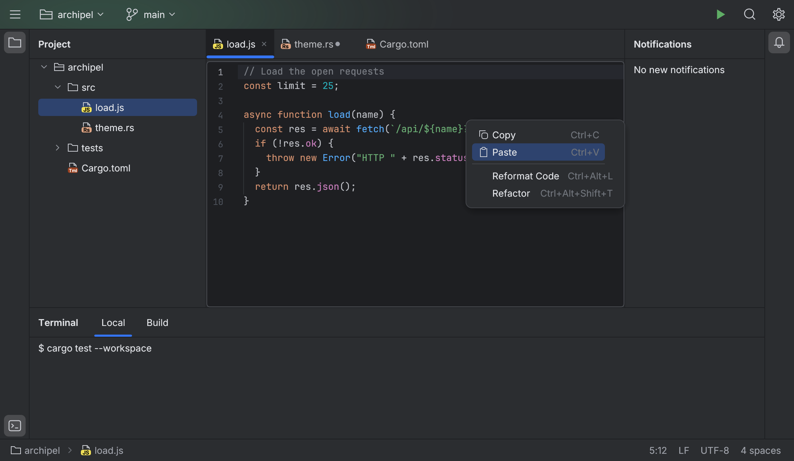
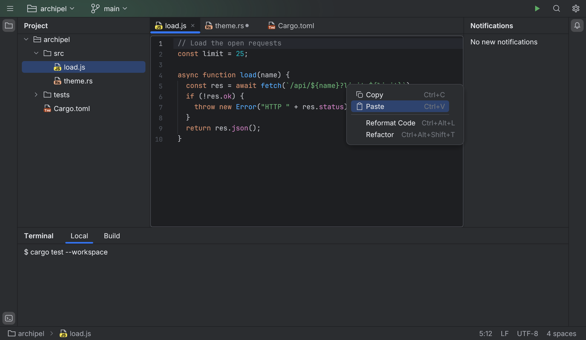
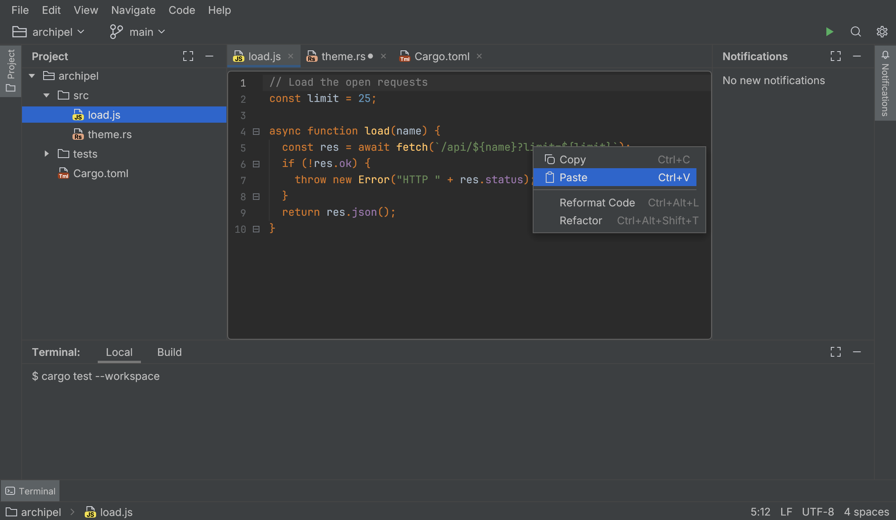
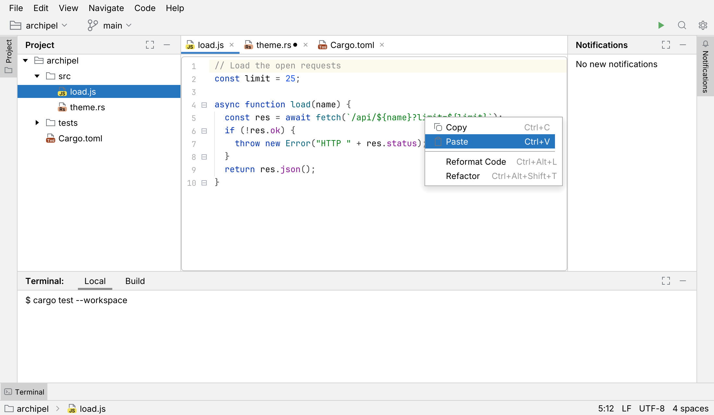

# UI looks

The kit draws every component in each of the three IntelliJ UI generations, switchable at
runtime, with compact density and the IntelliJ view modes on top. A look changes geometry
and structure; a [theme](theming.md) changes colors. Both live in the `egui::Context`, so two
windows can differ.

| Look | What changes |
|---|---|
| **Islands** (default) | Rounded islands on the window frame, 4 pt gaps, square icon stripes, pill tabs, no status bar line. Android Studio's and IntelliJ's default. |
| **New UI** | The same structure without islands: flush panels separated by 1 px lines, a 1 px line under the header, on the stripes and on top of the status bar, underline tabs (4 pt, radius 2). |
| **Classic** | The pre-2022 UI: a menu bar row and a classic toolbar, rotated text stripe buttons on three stripes, 28 pt tool window headers with always-visible actions and an active-header highlight, 3 pt underline tabs with a close button on every tab, flat full-row selection, square menus, classic folding outline, gradient buttons. |

```rust
use archipel_kit::{LookSettings, Theme, UiLook, ViewMode, look};

# let ctx = egui::Context::default();
// At startup: a theme and a look (or `install(ctx, theme)` for Islands).
archipel_kit::install_with_look(&ctx, Theme::darcula(), LookSettings::new(UiLook::Classic));

// At runtime, from a setting or an action:
look::set_look(&ctx, UiLook::NewUi);
look::set_compact(&ctx, true); // no effect in Classic, as in the IDE
look::set_view_mode(&ctx, ViewMode::distraction_free());

// A theme suggests the look it was made for; the application decides.
assert_eq!(Theme::darcula().suggested_look(), UiLook::Classic);
assert_eq!(Theme::new_ui_dark().suggested_look(), UiLook::NewUi);

// Components read the resolved sizes:
let metrics = archipel_kit::tokens::metrics(&ctx);
assert_eq!(metrics.row_height, 22.0);
```

The `tokens::*` constants keep the Islands values; [`Metrics`](../crates/archipel-kit/src/look.rs)
holds everything that differs between looks and densities. The gallery has a look picker,
a Compact switch and a view mode picker next to its theme pickers.

## The looks side by side

The same page (main menu, toolbar, Project tree with a selection, editor tabs, editor with
folding, a Terminal tool window with content tabs, Notifications, status bar and a context
menu) in each look.

| | Normal | Compact |
|---|---|---|
| Islands (Islands Dark) |  |  |
| New UI (New UI Dark) |  |  |
| Classic (Darcula) |  | _no compact mode_ |
| Classic (IntelliJ Light) |  | _no compact mode_ |

Selected rows and highlighted menu items use the theme's selection foreground
(`List.selectionForeground`): white on the classic light themes' dark blue selection.

## Metrics

Values in points; "c" is compact density. Sources: the IntelliJ looks spec (§2, §6, §8.2);
values marked (est.) are derived from font metrics and insets in IntelliJ and wait for a
measurement with `tools/reference/`.

| `Metrics` field | Islands | New UI | Classic |
|---|---|---|---|
| `row_height` | 24 (c 22) | 24 (c 22) | 20 |
| `tree_indent` | 19 | 19 | 18 |
| `row_inset` / `row_pill_inset` / `row_radius` | 12 (c 8) / 4 / 4 | 12 (c 8) / 4 / 4 | 0 / 0 / 0 (full row) |
| `expander` | chevron | chevron | triangle |
| `table_header_height` | 28 | 28 | 25 |
| `header_height` (tool window header, tab strip) | 40 (c 30) | 40 (c 30) | 28 |
| `window_toolbar_height` | 40 (c 32; Distraction Free 30) | 40 (c 32; 30) | 30 (est.) + `menu_bar_height` 24 (est.) |
| `toolbar_button` / `toolbar_icon` | 30 / 20 (c 26 / 16) | 30 / 20 (c 26 / 16) | 22 / 16 |
| `control_height` / `control_height_small` | 28 / 24 (c 24 / 20) | 28 / 24 (c 24 / 20) | 24 / 20 |
| `control_radius` | 4 (c 3) | 4 (c 3) | 3 |
| `button_gradient` | no | no | yes (`Button.startBackground` → `endBackground`) |
| `island_gap` / `island_radius` | 4 / 10 (c 3 / 8) | 0 / 0 | 0 / 0 |
| `split_divider` | the gap | 1 | 1 |
| `status_bar_height` | 30 (c 25) | 31 (c 26) (est.) | 23 |
| `status_top_line` | 0 | 1 | 1 |
| `status_hover_radius` | 4 | 2 | 0 |
| `popup_padding` / `popup_item_inset` / `popup_item_padding` | 8 / 8 / 8 | 8 / 8 / 8 | 4 / 0 / 12 |
| `popup_row_height` / `popup_radius` | 24 (c 22) / 8 | 24 (c 22) / 8 | 22 (est.) / 0 |
| `tab_style` | pill | underline | underline |
| `tab_height` | 28 (c 24) | the strip | the strip |
| `tab_gap` / `tab_strip_inset` | 6 (c 4) / 6 | 0 / 0 | 0 / 0 |
| `tab_padding_left` / `tab_padding_right` | 8 / 4 | 8 / 6 | 6 / 4 |
| `tab_underline` / `tab_underline_radius` | 0 | 4 / 2 | 3 / 0 |
| `tab_close_always` | no | no | yes |
| `stripe_style` | icons | icons | text (`Stripe`, `StripeButton`) |
| `stripe_width` | 38 (c 35) | 41 (c 33) | 27 (est.) |
| `stripe_button` / `stripe_pitch` / `stripe_icon` | 30 / 40 / 20 (c 24 / 32 / 16) | 30 / 40 / 20 (c 24 / 32 / 16) | text / text / 13 |
| `header_actions_always` / `active_header_highlight` / `header_line_always` | no | no | yes |
| `tooltip_padding_x` / `tooltip_padding_y` | 16 / 9 | 16 / 9 | 10 / 7 |
| `folding` | hover chevrons | hover chevrons | outline, square anchors |
| `navbar_in_status_bar` | yes | yes | no |

## View modes

`ViewMode` flags are orthogonal to the look. Components honor them:

| Mode | Effect in the kit |
|---|---|
| Presentation | `set_view_mode` zooms the context by 1.75 (editor text included) and restores the zoom when it ends; `ToolWindowPane` hides the stripes, the status bar and the tool windows (their state is kept), `JBTabs` hides the editor tabs, the editor centers its text and hides folding. |
| Distraction Free | The main toolbar keeps only the 30 pt header (its widgets are hidden), stripes, status bar and editor tabs are hidden, the editor hides line numbers, gutter icons and folding and centers its text: the left margin puts the right margin column (120) in the middle (`editor::distraction_free_margin`, IntelliJ's automatic rule for `editor.distraction.free.margin = -1`). |
| Full screen | Frame decoration only: the host's job. Zen is Distraction Free in full screen (`ViewMode::zen`, `is_zen`). |

## Not covered yet

- Classic stripe buttons do not drag between stripes and have no mnemonic numbers by default
  (`StripeButton::number` adds them).
- Classic scroll bars (13 pt, always visible) and the New UI editor strip scroll bar rules:
  every look keeps the Islands overlay bars.
- Compact gutter gaps (`Metrics::gutter_gap`) are resolved but the editor keeps its
  measured Islands gaps.
- The Classic navigation bar above the editor (`navbar_in_status_bar` is false in Classic;
  where the bar goes is the application's choice).
