# Theming

The selected kit theme also sets egui's appearance explicitly, so native system appearance
cannot make plain egui popups disagree with kit components. Switching themes preserves
the installed typography and spacing.

## Themes

A `Theme` is plain data: workbench `colors`, `editor` colors, a name and whether it is dark.
`Theme::dark()` and `Theme::light()` are built in; `install` or `Theme::apply` stores a theme
in the `egui::Context`, and components read it with `Theme::colors(ctx)`. Two contexts (two
windows, two tests running in parallel) can use different themes at the same time.

```rust
use archipel_kit::{Theme, egui};

fn use_sunset(ctx: &egui::Context) {
    let mut theme = Theme::dark();
    theme.name = "Sunset".into();
    theme.colors.accent = egui::Color32::from_rgb(0xE0, 0x88, 0x55);
    theme.apply(ctx);
}
```

Use the semantic colors in your own widgets so they follow the theme:

| Group | Colors |
|---|---|
| Surfaces | `frame`, `island`, `popup`, `popup_border`, `field`, `notification`, `tooltip` (`Surface::Chrome` paints the workbench frame, toolbars and the status bar in `frame`) |
| Text | `text`, `text_strong`, `text_secondary`, `text_placeholder`, `text_disabled`, `text_on_accent`, `text_on_accent_disabled` |
| Interaction | `hover`, `pressed`, `selection`, `accent`, `focus_ring`, `border`, `separator` |
| Semantic | `error`, `warning`, `success`, `link`, `banner_*` |
| Developer tools | `run`, `stop`, `vcs_modified`, `vcs_added`, `vcs_untracked`, `vcs_ignored` |
| Data | `categorical`, `sequential` (see [Data colors](#data-colors)) |

The test suite checks WCAG contrast of text on islands (7:1) and secondary text (4.5:1) for
the built-in themes; keep custom themes readable too.

## Bundled IntelliJ themes and editor schemes

Besides the two hand-measured themes, the kit ships every UI theme and editor color scheme
bundled with IntelliJ Community (`idea/262.10968.63`), generated from the upstream data files
by [`tools/themes`](../tools/themes/README.md) (Apache-2.0 facts, see
[`NOTICE.md`](../NOTICE.md)). `Theme::dark()` and `Theme::light()` stay exactly as measured:
they are the default and the snapshots of every component depend on them.

| Constructor | Theme | Editor scheme it selects |
|---|---|---|
| `Theme::islands_dark()` | Islands Dark | Islands Dark |
| `Theme::islands_light()` | Islands Light | New UI Light |
| `Theme::islands_darcula()` | Islands Darcula | Darcula |
| `Theme::high_contrast()` | High Contrast (Islands) | High Contrast |
| `Theme::new_ui_dark()` | New UI Dark | New UI Dark |
| `Theme::new_ui_light()` | New UI Light | New UI Light |
| `Theme::light_with_light_header()` | Light with Light Header | New UI Light |
| `Theme::darcula()` | Darcula (classic) | Darcula |
| `Theme::intellij_light()` | IntelliJ Light (classic) | IntelliJ Light |
| `Theme::classic_high_contrast()` | High Contrast (classic) | High Contrast (Classic) |
| `Theme::macos_light()` | macOS Light | Default |
| `Theme::windows10_light()` | Windows 10 Light | Default |

Editor schemes (`EditorScheme::all()`): Default, Darcula, Islands Dark, New UI Dark, New UI
Light, Darcula Contrast, IntelliJ Light, High Contrast, High Contrast (Classic), Monokai,
Twilight, Blackboard, Cobalt, All Hallows Eve, Warm Neon, GitHub, Vibrant Ink and Rails
Casts. Any UI theme combines with any scheme:

```rust
use archipel_kit::{EditorScheme, Theme, egui};

fn pick(ctx: &egui::Context) {
    // A picker lists `Theme::all()` (name, dark, constructor) and `EditorScheme::all()`.
    for info in Theme::all() {
        let _ = (info.id, info.name, info.dark);
    }
    let monokai = EditorScheme::by_id("monokai").expect("bundled");
    let theme = Theme::islands_dark().with_editor_scheme(monokai);
    theme.apply(ctx);
}
```

The gallery has both pickers in its toolbar. Every theme below renders the same page: a tool
window, an editor island and controls (`tests/theme_gallery.rs` takes these snapshots).

<table>
<tr>
<td>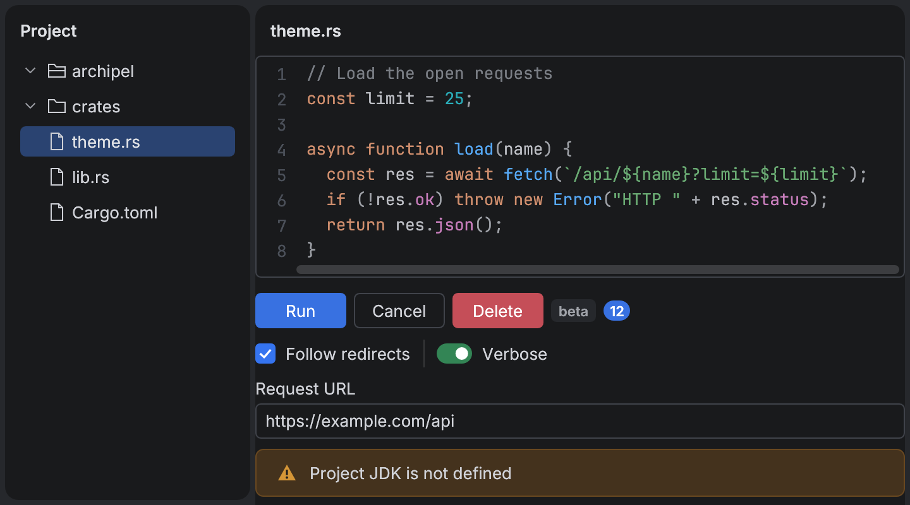<br>Archipel Dark, <code>dark()</code></td>
<td><br>Archipel Light, <code>light()</code></td>
<td>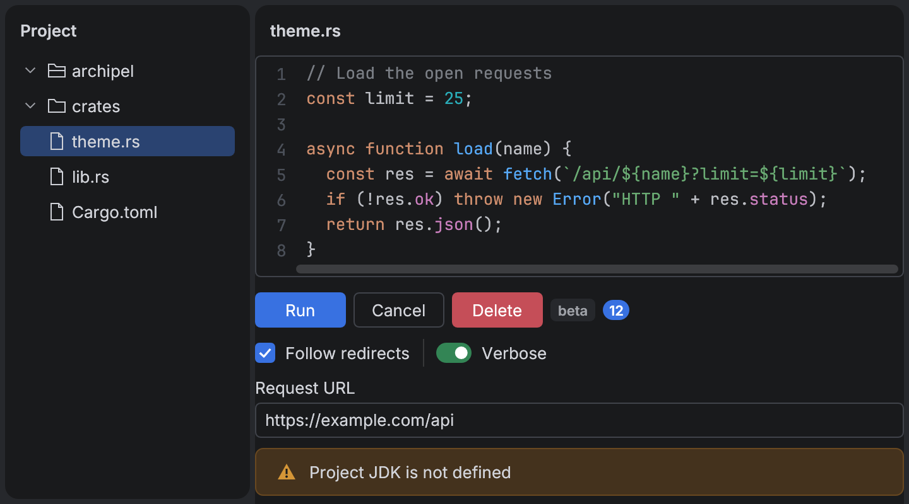<br>Islands Dark</td>
</tr>
<tr>
<td>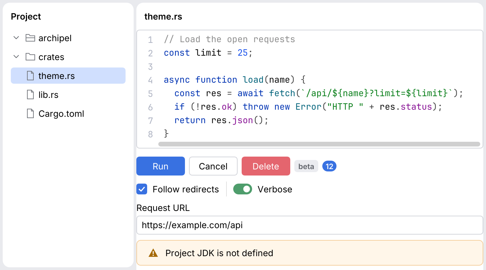<br>Islands Light</td>
<td>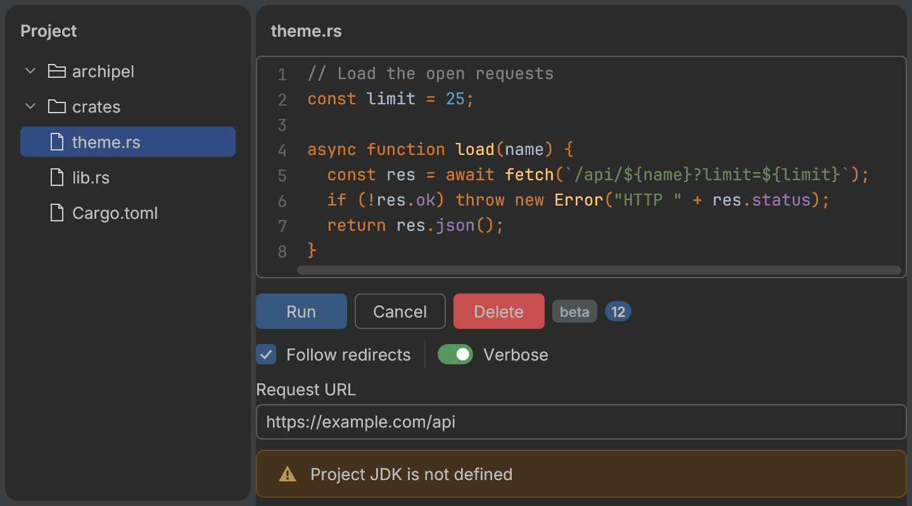<br>Islands Darcula</td>
<td>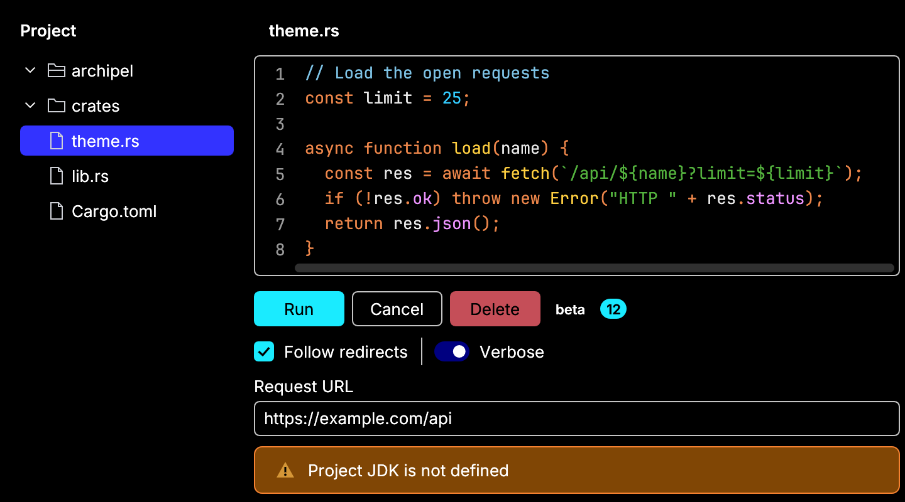<br>High Contrast</td>
</tr>
<tr>
<td>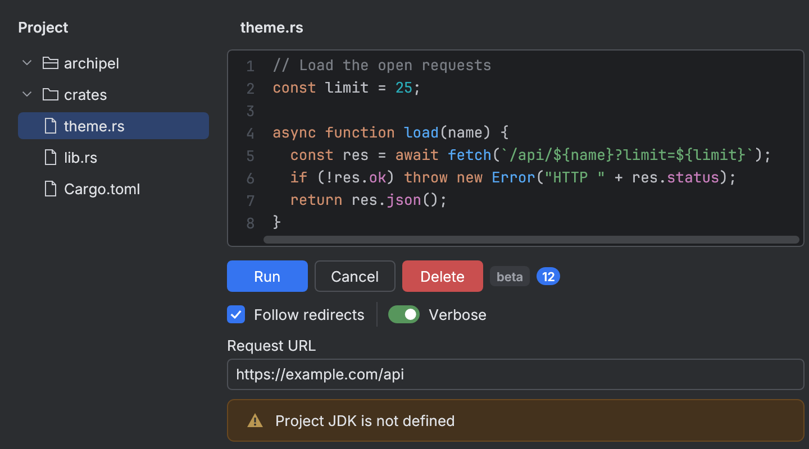<br>New UI Dark</td>
<td>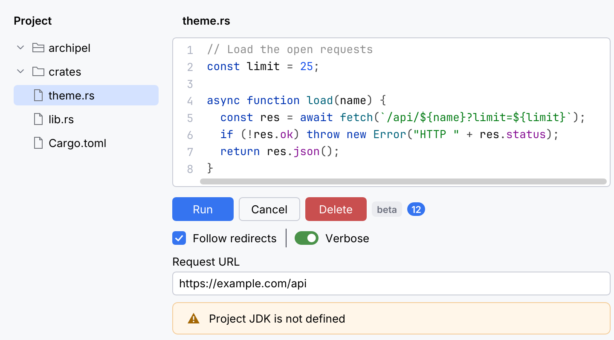<br>New UI Light</td>
<td>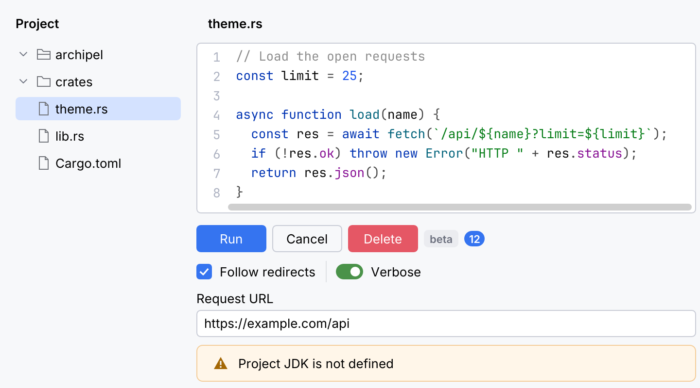<br>Light with Light Header</td>
</tr>
<tr>
<td>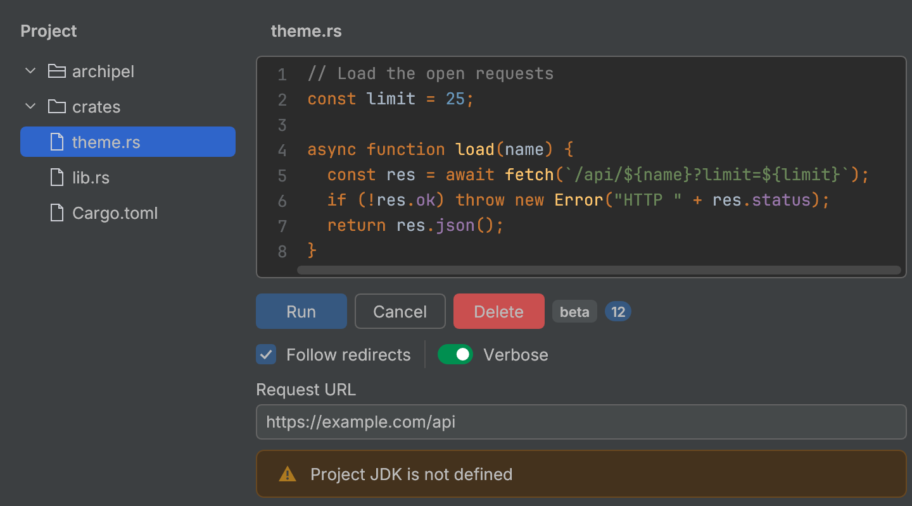<br>Darcula</td>
<td>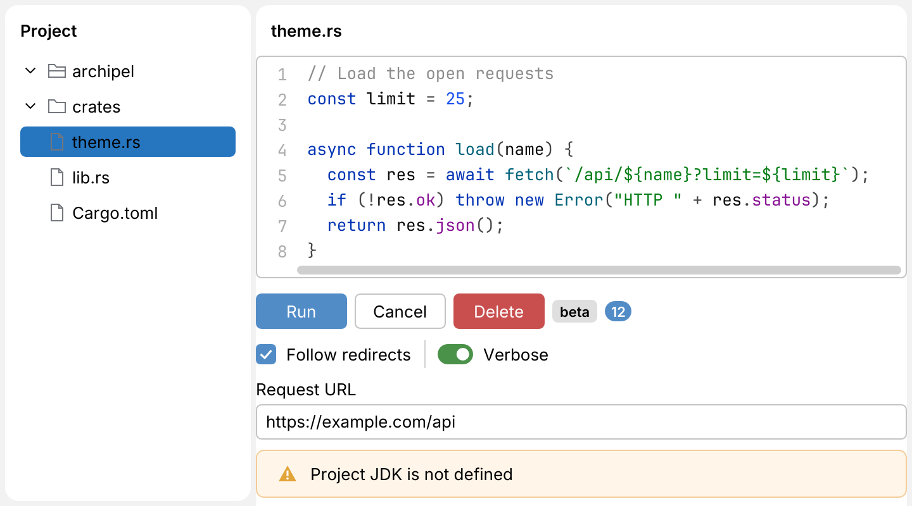<br>IntelliJ Light</td>
<td>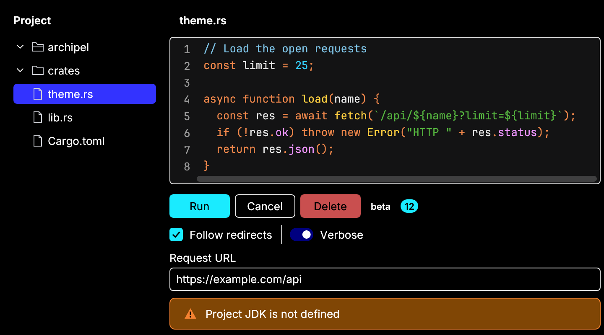<br>High Contrast (classic)</td>
</tr>
<tr>
<td>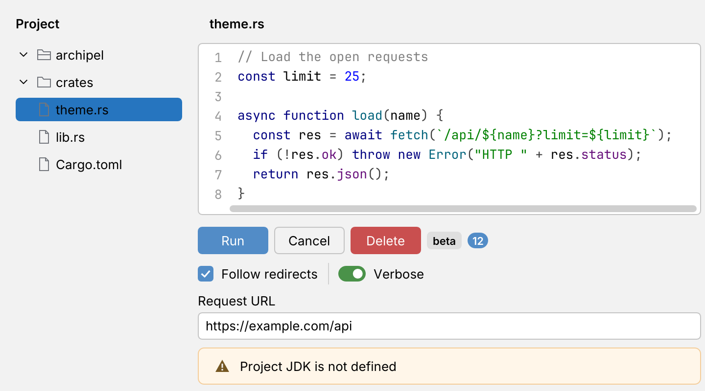<br>macOS Light</td>
<td>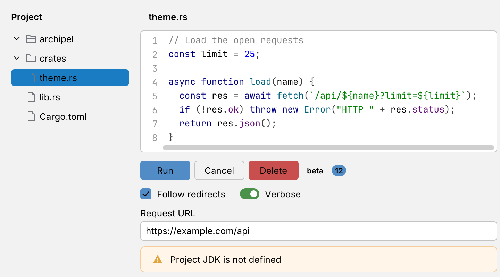<br>Windows 10 Light</td>
<td>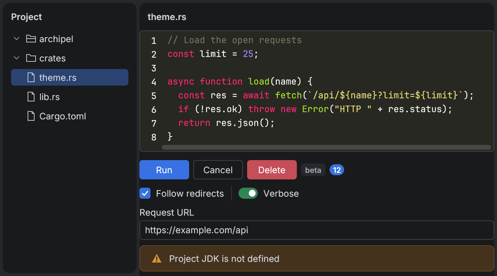<br>Islands Dark + Monokai scheme</td>
</tr>
</table>

### IntelliJ keys, geometry and text attributes

Each generated theme keeps the full table of IntelliJ UIManager keys its theme files define
(parent themes merged, named colors and `*` entries resolved), so a component can ask for an
IntelliJ token the kit has no field for:

```rust
use archipel_kit::{Theme, egui};

fn header(ctx: &egui::Context) -> Option<egui::Color32> {
    // `None` for the hand-built themes or a key the theme does not define.
    Theme::current(ctx).ui_color("ToolWindow.Header.background")
}
```

`ui_color`, `ui_number` (`"Island.arc"`), `ui_flag`, `ui_insets` (`"4,12,4,12"`) and `ui_size`
(`"72,28"`) read the table; `ui_theme_chain()` names the theme files it was merged from.
Editor schemes keep every text attribute (`TextAttributesKey`: foreground, background, bold
and italic, effect, error stripe color) for a syntax highlighter:
`theme.text_attributes("DEFAULT_KEYWORD")` or `scheme.attributes(..)`, `scheme.color("CARET_ROW_COLOR")`,
resolved through `baseAttributes` and the `parent_scheme` chain.

**Geometry follows the Islands look for every theme for now.** The tables record each theme's
geometry keys (`Island.arc`, `Island.borderWidth`, `Button.arc`, `Component.arc`,
`Tree.rowHeight`, ...; the full per-theme list is in [theme mapping](theme-mapping.md#geometry)),
but the classic themes (Darcula, IntelliJ Light, macOS, Windows 10) have no islands, and
components keep the measured Islands geometry whatever theme is installed. Only colors change.

### How the colors are mapped

`Colors` and `EditorColors` are filled from the IntelliJ keys by one table, `COLORS` and
`EDITOR` in [`tools/themes/mapping.py`](../tools/themes/mapping.py): kit field, then IntelliJ
keys in order of preference (`ui:ToolWindow.background`, `attr:DEFAULT_KEYWORD.fg`,
`color:CARET_ROW_COLOR`, `scheme:FILESTATUS_ADDED`, derived values such as
`mix:self:text|self:island|num:EditorTabs.unselectedAlpha`). To map a new `Colors` field, add a
line there and regenerate. A field with no resolvable key keeps the measured value of
`Theme::dark()` (dark themes) or `Theme::light()` (light themes); a field nobody mapped yet
does too, so fields added to `Colors` never break a bundled theme. The data viz palettes
(`categorical`, `sequential`) are the kit's own and are not part of any IntelliJ theme.
[Theme mapping](theme-mapping.md) (generated) lists the whole table, which fields fell back in
which theme, and the comparison below in full.

**Validation.** The generated Islands Dark and Islands Light must land on what was measured
on the running IDE (`Theme::dark()`, `Theme::light()`). Of the fields with an IntelliJ key
most are identical; the table lists every field that is not (hex, `/NN` is alpha). "kept" means
no IntelliJ token exists for the field, so the measured value is used. The differences are
tokens the theme data does not define the way the measured IDE draws them: values the IDE
derives in code (text of unselected tabs, the completion popup selection, the accent of a
checked checkbox), syntax roles where the kit picks another scheme attribute than the one
measured (`constant`, `punctuation`, `tag`, `attribute`), and kit-only roles with no IntelliJ
key. They stay documented here; `dark()` and `light()` are not patched to match.

<!-- generated:validation:begin -->
**`Colors`, `islands_dark` vs `Theme::dark()`:** 52 exact, 1 near, 6 differ, 10 kept (no IntelliJ key).

| Field | Measured (`Theme::dark()`) | Generated (`islands_dark`) | Verdict | Source |
|---|---|---|---|---|
| `text_strong` | #DFE1E5 | #D1D3D9 | differs (14) | `Label.foreground` |
| `selection_popup` | #113A5C | #2A4371 | differs (25) | `CompletionPopup.selectionBackground` |
| `accent_disabled` | #4E5157 | _kept (no key)_ | measured value | - |
| `text_on_accent_disabled` | #B0B3BA | _kept (no key)_ | measured value | - |
| `tab_text` | #AFB1B6 | #A3A5AA | differs (12) | `mix(self:text, self:island, num:EditorTabs.unselectedAlpha)` |
| `tab_scroll_thumb` | #434344 | _kept (no key)_ | measured value | - |
| `tab_scroll_thumb_hover` | #535455 | _kept (no key)_ | measured value | - |
| `control_border` | #5A5D63 | #5F6269 | near (6) | `ToggleButton.borderColor` |
| `control` | #2B2D30 | _kept (no key)_ | measured value | - |
| `control_selected` | #3574F0 | #3871E1 | differs (15) | `Button.default.startBackground` |
| `clear_icon` | #676B71 | _kept (no key)_ | measured value | - |
| `clear_icon_hover` | #7F8389 | _kept (no key)_ | measured value | - |
| `clear_hover` | #353637 | _kept (no key)_ | measured value | - |
| `vcs_modified` | #71A1FE | #70AEFF | differs (13) | `scheme FILESTATUS_MODIFIED` |
| `vcs_untracked` | #E37774 | #E88F89 | differs (24) | `scheme FILESTATUS_UNKNOWN` |
| `icon` | #CED0D6 | _kept (no key)_ | measured value | - |
| `folder_fill` | #43454A | _kept (no key)_ | measured value | - |

**`EditorColors`, `islands_dark` with scheme Islands Dark vs `Theme::dark()`:** 27 exact, 1 near, 5 differ, 1 kept.

| Field | Measured (`Theme::dark() editor`) | Generated (`islands_dark + Islands Dark`) | Verdict | Source |
|---|---|---|---|---|
| `background_panel` | #212326 | #27282B | near (6) | `DOCUMENTATION_COLOR` |
| `constant` | #9E86C8 | #C77DBB | differs (41) | `DEFAULT_CONSTANT.fg` |
| `punctuation` | #9FA2A8 | #BCBEC4 | differs (29) | `DEFAULT_COMMA.fg` |
| `tag` | #E8BA36 | #D5B778 | differs (66) | `XML_TAG_NAME.fg` |
| `attribute` | #B3AE60 | #BCBEC4 | differs (100) | `XML_ATTRIBUTE_NAME.fg` |
| `invalid` | #FA6675 | #F75464 | differs (18) | `BAD_CHARACTER.fg` |
| `search_result_current` | #1F7C94 | _kept (no key)_ | measured value | - |

**`Colors`, `islands_light` vs `Theme::light()`:** 53 exact, 0 near, 6 differ, 10 kept (no IntelliJ key).

| Field | Measured (`Theme::light()`) | Generated (`islands_light`) | Verdict | Source |
|---|---|---|---|---|
| `selection_popup` | #C5DFFC | #D0DFFE | differs (11) | `CompletionPopup.selectionBackground` |
| `accent_disabled` | #DDDFE4 | _kept (no key)_ | measured value | - |
| `text_on_accent_disabled` | #60636A | _kept (no key)_ | measured value | - |
| `tab_text` | #515151 | #404040 | differs (17) | `mix(self:text, self:island, num:EditorTabs.unselectedAlpha)` |
| `tab_scroll_thumb` | #ABABAB | _kept (no key)_ | measured value | - |
| `tab_scroll_thumb_hover` | #7F7F7F | _kept (no key)_ | measured value | - |
| `control_border` | #A8ADBD | #C3C5CB | differs (27) | `ToggleButton.borderColor` |
| `control` | #FFFFFF | _kept (no key)_ | measured value | - |
| `control_selected` | #3574F0 | #3871E1 | differs (15) | `Button.default.startBackground` |
| `clear_icon` | #B0B4C3 | _kept (no key)_ | measured value | - |
| `clear_icon_hover` | #8A8E9C | _kept (no key)_ | measured value | - |
| `clear_hover` | #EBEBED | _kept (no key)_ | measured value | - |
| `vcs_modified` | #2F5EB9 | #0033B3 | differs (47) | `scheme FILESTATUS_MODIFIED` |
| `vcs_ignored` | #818594 | #6C707E | differs (22) | `scheme FILESTATUS_DELETED` |
| `icon` | #73767C | _kept (no key)_ | measured value | - |
| `folder_fill` | #EBECF0 | _kept (no key)_ | measured value | - |

**`EditorColors`, `islands_light` with scheme New UI Light vs `Theme::light()`:** 27 exact, 1 near, 5 differ, 1 kept.

| Field | Measured (`Theme::light() editor`) | Generated (`islands_light + New UI Light`) | Verdict | Source |
|---|---|---|---|---|
| `background_panel` | #F7F8F9 | #FFFFFF | near (8) | `DOCUMENTATION_COLOR` |
| `constant` | #7A3E9D | #871094 | differs (46) | `DEFAULT_CONSTANT.fg` |
| `type_name` | #00627A | #007E8A | differs (28) | `TYPE_PARAMETER_NAME_ATTRIBUTES.fg` |
| `annotation` | #8A6D00 | #9E880D | differs (27) | `DEFAULT_METADATA.fg` |
| `punctuation` | #5C5F6B | #464646 | differs (37) | `mix(self:text, self:background, 0.25)` |
| `comment` | #7C7F8A | #8C8C8C | differs (16) | `DEFAULT_LINE_COMMENT.fg` |
| `search_result_current` | #F2A33A | _kept (no key)_ | measured value | - |

<!-- generated:validation:end -->

## Data colors

Data-heavy tools (JSON trees, document tables, response viewers, charts) take their colors
from the theme too, never from hard-coded values.

<picture>
  <source media="(prefers-color-scheme: dark)" srcset="components/img/data-colors.dark.png">
  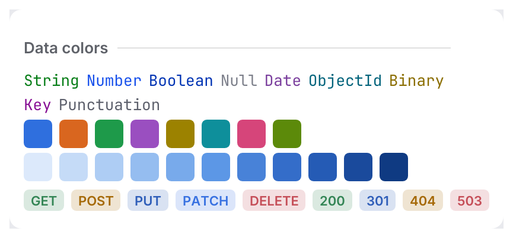
</picture>

### Typed values

`ValueKind` is the type of a value in a data view. `kind.color(&theme)` or
`kind.resolve(ctx)` returns the editor syntax color, so values match the code editor.
It is separate from `Tone` because the colors live in `EditorColors`, not `Colors`.

| `ValueKind` | `EditorColors` field |
|---|---|
| `String` | `string` |
| `Number` | `number` |
| `Boolean` | `keyword` |
| `Null` | `comment` |
| `Date` | `constant` |
| `Id` (ObjectId) | `type_name` |
| `Binary` | `annotation` |
| `Key` | `property` |
| `Punctuation` | `punctuation` |

The syntax fields are new in `EditorColors`: `string`, `number`, `keyword`, `constant`,
`type_name`, `annotation`, `property`, `punctuation`, `comment`. Custom themes must set them;
the tests require 3:1 against the editor background for the built-in themes.

```rust
use archipel_kit::{ValueKind, egui};

fn json_number(ui: &mut egui::Ui, value: f64) {
    let color = ValueKind::Number.resolve(ui.ctx());
    ui.label(egui::RichText::new(value.to_string()).monospace().color(color));
}
```

### Charts

`Colors::categorical` (also `Theme::chart(index)` and `Colors::chart(index)`, wrapping after
8) holds eight series colors. Each has at least 3:1 contrast against `island` and a
distance of at least 60 (RGB) from every other series; a test checks both for the built-in
themes. Don't use color alone to tell series apart in dense charts: add labels or markers.

`Colors::sequential` is a five-stop ramp for heatmaps and histograms; `colors.ramp(t)` blends
it for `t` in 0..=1. Higher values are further from the island in luminance (brighter in
dark, darker in light), so "more" always stands out.

```rust
use archipel_kit::{Theme, egui};

fn bar(ui: &mut egui::Ui, series: usize, rect: egui::Rect, share: f32) {
    let colors = Theme::colors(ui.ctx());
    ui.painter().rect_filled(rect, 2.0, colors.chart(series));
    let _cell = colors.ramp(share);
}
```

### HTTP methods and statuses

`Tone::method("GET")` and `Tone::status(404)` return an ordinary `Tone`, for `Tag`, text and
icons. Methods: GET success, POST warning, PUT link, PATCH accent, DELETE error, HEAD and
OPTIONS secondary, anything else default (case-insensitive). Statuses: 1xx secondary, 2xx
success, 3xx link, 4xx warning, 5xx error, anything else muted.

## Tokens

`archipel_kit::tokens` holds the shared measurements, so custom widgets line up with the
components:

| Module | Examples |
|---|---|
| `size` | `ROW_HEIGHT` 24, `CONTROL_HEIGHT` 28, `ICON` 16, `CONTENT_INSET` 12, `HEADER_HEIGHT` 31 |
| `radius` | `ISLAND` 10, `POPUP` 8, `CONTROL` 4 |
| `typography` | `BODY` 13, `SMALL` 11, `semibold(ctx, size)`, `mono_bold(ctx, size)` |

## Where the colors come from

The built-in palettes are derived from public, Apache-2.0 licensed theme data (see
[`NOTICE.md`](../NOTICE.md)). No third-party code, icons or artwork are included. The bundled
IntelliJ themes are regenerated from a checkout of `intellij-community` with
`python3 -I tools/themes/generate.py --community PATH --tag TAG` (details in
[`tools/themes/README.md`](../tools/themes/README.md)); the output is deterministic.
