# Archipel Kit TUI

`archipel-kit-tui` is Archipel Kit for the terminal, built on [ratatui](https://ratatui.rs). It
**looks like NvChad** (the Neovim distribution) and **behaves like an IntelliJ app**: the same
component names, the same actions (`action_system`), the same keymap, the same selection and
speed search models and the same timings as the GUI kit. An app built on the kit can ship a
terminal version next to its GUI.

<picture>
  <source media="(prefers-color-scheme: dark)" srcset="img/ide.dark.svg">
  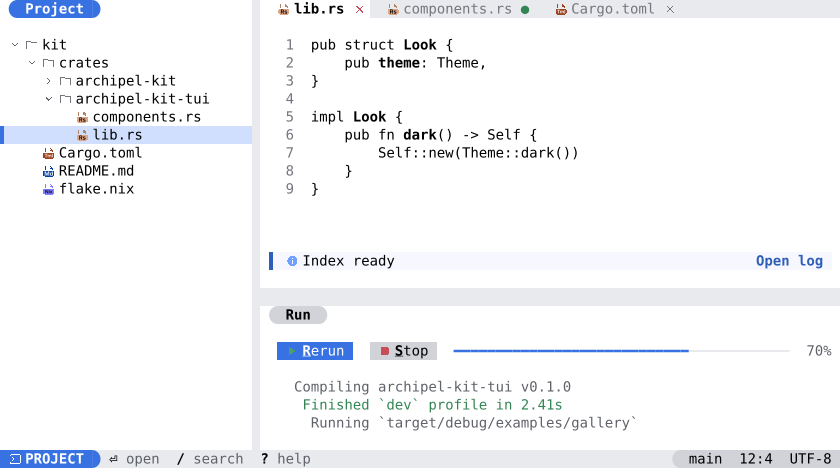
</picture>

The chrome of an IDE (toolbar, main menu, stripes, tool window headers, editor tabs, status bar,
breadcrumbs) is drawn from the shared component model and looks like the GUI, not like NvChad:
see [GUI-faithful chrome](#gui-faithful-chrome).

Run it: `cargo run -p archipel-kit-tui --example ide`. The smaller `gallery` example shows the
controls.

## Font: use a Nerd Font

All icons in the TUI are [Nerd Font](https://www.nerdfonts.com) characters: codicons for kit
glyphs and symbols, language logos for files, Material Design checkbox and switch icons, and
Powerline half circles for the rounded ends of status segments and chips. Set the terminal font
to a Nerd Font. We recommend **JetBrainsMono Nerd Font** (the plain variant, not "Mono": the
Mono variant shrinks the icons to one cell). The components leave a space after every icon for
it to draw into.

```bash
# macOS
brew install --cask font-jetbrains-mono-nerd-font
# Linux: download JetBrainsMono.zip from the Nerd Fonts releases into ~/.local/share/fonts
```

Use a terminal with 24-bit color: WezTerm, kitty, Ghostty, iTerm2, Windows Terminal, Alacritty,
GNOME Terminal.

The images on this page are SVG snapshots from the tests. A browser has no Nerd Font, so icon
cells show the matching Archipel icon, and half circles, box marks and frame lines are drawn as
shapes. In a terminal the font draws them; the two look alike.

## How the GUI maps to cells

The colors and icons come from the GUI theme; the look is NvChad's. Every IntelliJ theme works:
`Look::new(theme)` derives NvChad's color roles ([`NvChadPalette`]) from any kit `Theme`, so all
bundled themes and editor schemes give a consistent terminal look.

| GUI | Terminal (NvChad) |
|---|---|
| Islands on a frame color | Flat full-bleed panes edge to edge, no gaps and no rounded blocks: the editor on `black`, side bars and the bottom pane on `darker_black`, separated by a thin `│` or `─` in the `line` color |
| Tool windows (left, right, bottom) | A side bar like nvim-tree whose title (`  Project`) sits in the top row on `darker_black`, the tabufline offset; a bottom pane like a toggled horizontal terminal split with a thin title line (and content tabs); the right pane is hidden until asked for. No header action icons |
| Tool window stripes | None (opt in with `Workbench::stripes(true)`). Open, focus and hide windows with Alt+digit (Ctrl+W then digit), Shift+Esc, Ctrl+Shift+F12, Find Action / Search Everywhere, or a click on the pane title (double click maximizes, middle or Shift click hides) |
| Tool window header actions | A right click on the pane title opens a context menu (Hide, Maximize, Hide All Tool Windows), and the same actions are in Find Action |
| Main toolbar (app name, Run/Stop, icons, Tools menu, run configuration combo) | None: the top row is the tabufline only. Run (Shift+F10), Debug (Shift+F9), Stop (Ctrl+F2) and the toggles are actions in Find Action and the keymap; the run configuration and its running state are a status line segment (` ide` / ` running`) that opens a Telescope picker (also Alt+Shift+F10); the project name is the status line's directory segment; the theme toggle and close-all are at the right end of the tabufline |
| Notifications tool window and balloons | `nvim-notify`-style floats; the Notifications window (Alt+3) is the history and hidden by default |
| Editor tabs (`JBTabs`) | The tabufline: `  <icon> name  󰅖` per buffer, the active one on the editor background with bright bold text, inactive ones on `black2` with grey text, a green dot for a modified buffer, theme and close-all buttons at the right end |
| Status bar and widgets | The default NvChad statusline: a mode block with a rounded end, file, git branch with `+ ~ -` counts, message in the center, diagnostics counts, language server, working directory and cursor position as colored segments; lower-priority segments drop first when narrow |
| Text field | A Telescope prompt: `black2` background, a colored title block as the label (or a search icon), a block caret |
| Selected row | The cursor line: a full-width bar on `one_bg3` (quieter on `black2` when the list has no focus); matches of the speed search are bold and underlined |
| `ListPopup`, Search Everywhere, combo list, dialogs | Telescope-style floats: a centered float, a colored title block, the prompt row, the results on `darker_black` with the selected row highlighted, borderless |
| `ActionPopupMenu`, `ComboBox` list | The completion menu (nvim-cmp): a raised surface, the selected item filled with the accent, kind icons in color, shortcuts grey at the right, submenus as adjacent floats |
| `HelpTooltip` | An LSP hover float: raised surface, thin rounded border, title, shortcut and description |
| Notification balloons | nvim-notify floats in the top-right corner with a rounded border in the severity color |
| Pending two-stroke shortcut | A which-key list at the bottom with the keys that complete the chord |
| `EditorComponent` | A sign column, a number column in grey with the current line bright, the cursor line on `black2`, indent guides as thin `│` in the `line` color, the selection as cell backgrounds, the caret as the terminal cursor, diagnostics as undercurl, find as a prompt row, completion as nvim-cmp; a dashboard (nvdash style) when no file is open |
| Buttons | A filled label with one cell of padding; the mnemonic underlined; focus shows `❯ … ❮` |
| `InlineBanner` | One row: an edge in the severity color, icon and text, actions as bold links |

## Interaction model

The runtime is an immediate mode loop like the GUI's, driven by events. Components are **stateless
like the GUI components**: they borrow state you own and say what happened. The state types are
the GUI kit's wherever they could be reused: `ListSelectionModel`, `SpeedSearchState`,
`ToolWindowPaneState`, `ToolWindow`/`ContentManager`, `NotificationsManager`, `PopupStep`,
`ActionGroup`, `DataContext`, `Keymap`, `ValidationInfo`, `ExitCode`.

- **[`App`]** is the trait you implement: `event`, `draw`, optionally `tick` and `deadline`.
  `runtime::run_app` sets the terminal up (raw mode, alternate screen, mouse capture, bracketed
  paste, focus reporting, the kitty keyboard protocol when available), runs the loop and restores
  the terminal, also on panic.
- **[`Runtime`]** carries what components need: the `Look`, the `Keymap`, the clock `now` in
  seconds, the `HitMap`, the `FocusManager`, the clipboard and the tooltip state. The delays are
  the GUI's (`tokens::motion`): tooltip 500 ms, submenu 250 ms, popup auto-selection 500 ms,
  reopen guard 200 ms, dialog validation 300 ms, balloon 10 s, second key of a chord 2 s.
- **Events** ([`Event`]): key press, key release (kitty terminals), mouse, resize, paste, focus
  gained and lost. `Runtime::preprocess` resolves each key event through the **same `Keymap` the
  GUI uses**, two-stroke chords included (`rt.actions()`), and each mouse event into a `Pointer`
  with click counts and the widget under it.
- **Hit map and focus**: while drawing, every interactive widget registers its rectangle
  (`rt.widget(id, rect)`); mouse events are resolved against that map, the topmost wins, and a
  modal layer blocks what is below. `rt.widget` also puts the widget in the focus order
  (Tab and Shift+Tab); a press on a focusable widget focuses it.
- **Layers** ([`overlay::Layers`]): popups, dialogs, tooltips and balloons above the app. The
  top modal layer gets every key and mouse event first; **Esc unwinds the top layer first**;
  balloons are above the app but below dialogs.
- **Clipboard**: copying publishes the text with the OSC 52 sequence; pasting arrives as a
  bracketed paste event from the terminal.

### Keys

Shortcuts are the GUI's. A legacy terminal cannot send some combos, so `terminal_keymap` adds
fallbacks (all also work in kitty-protocol terminals), and tooltips and menus show the shortcut
the terminal can send (`Runtime::shortcut_text`).

| Action | GUI shortcut | Terminal fallback |
|---|---|---|
| Activate tool window 1..9 | Alt+1..9 | Ctrl+W, then 1..9 (Option+digit types a symbol on macOS) |
| Hide active tool window | Shift+Esc | none needed |
| Hide all tool windows | Ctrl+Shift+F12 | Ctrl+W, then H |
| Maximize tool window | Ctrl+Shift+' | Ctrl+W, then M |
| Resize tool window | Ctrl+Alt+Shift+arrows | Ctrl+W, then an arrow |
| Back to the editor | Esc | none needed |
| Jump to last tool window | F12 | none needed |
| Go to Action / Search Everywhere | Ctrl+Shift+A, double Shift | Ctrl+P, Ctrl+K then A; double Shift needs modifier key reporting (kitty protocol) |
| Find in Path | Ctrl+Shift+F | Ctrl+K, then F |
| Redo | Ctrl+Shift+Z | Ctrl+K, then Z |
| Switcher | Ctrl+Tab | Ctrl+K, then T |
| Close active tab | Ctrl+Shift+F4 | Ctrl+K, then W (Ctrl+F4 works too) |
| Next / previous tab | Alt+Right / Alt+Left | none needed |
| Copy, Cut, Paste, Select All, Undo | Ctrl+C, X, V, A, Z | none needed (the terminal's own paste arrives as a paste event) |

Chords show a which-key list after the first stroke and time out after two seconds.

### Mouse

Click, double click, drag, wheel and right click work everywhere (mouse capture is on):

| Where | Mouse |
|---|---|
| Buttons, check boxes, switches | press and release inside clicks; dragging off cancels |
| Lists, trees, tables | click selects, Ctrl+click toggles, Shift+click and drag extend, double click activates or expands, the wheel scrolls three rows, right click selects the row unless it is selected and asks for a context menu, the chevron toggles a node, header click sorts, the column divider drags |
| Popups | hover selects (not on the first move), resting 250 ms opens a submenu, a click chooses on release, the chevron opens without choosing, a press outside cancels |
| Tabs | a press selects at once, middle click or Shift+click closes, the close icon closes after 150 ms of hover, dragging reorders, the wheel scrolls, right click asks for the menu |
| Tool windows | stripe buttons toggle (middle or Shift+click hides, right click asks for a menu), header double click maximizes, the minimize button hides, separators drag, double click on a separator resets it |
| Status bar | slots highlight on hover, show tooltips, report clicks; right click asks for the widget menu |
| Text fields | click places the caret, double click selects a word, triple click all, drag selects |
| Balloons | hover pauses the timer, the close icon dismisses, links run actions |

## Getting started

```toml
[dependencies]
archipel-kit-tui = { git = "https://github.com/archipel-dev/kit" }
```

An app is a state, an event handler and a draw function:

```rust
use archipel_kit_tui::components::{Pane, PaneKind};
use archipel_kit_tui::controls::{ButtonControl, ButtonState};
use archipel_kit_tui::ratatui::{buffer::Buffer, layout::Rect, widgets::Widget};
use archipel_kit_tui::{App, Event, Id, Look, Runtime};

const OK: Id = Id::new("ok");

#[derive(Default)]
struct Hello {
    button: ButtonState,
    clicks: u32,
}

impl App for Hello {
    fn event(&mut self, rt: &mut Runtime, event: &Event) {
        if ButtonControl::new(OK, "Say hi").primary().handle(rt, &mut self.button, event) {
            self.clicks += 1;
        }
        if rt.is_action("Exit") {
            rt.quit = true;
        }
    }

    fn draw(&mut self, rt: &mut Runtime, area: Rect, buf: &mut Buffer) {
        Pane::new(&rt.look).kind(PaneKind::Editor).render(area, buf);
        ButtonControl::new(OK, "Say hi").primary().show(rt, &self.button, 2, 1, buf);
    }
}

// In `main`: archipel_kit_tui::runtime::run_app(Look::dark(), &mut Hello::default(), Default::default())
```

Test the same code without a terminal: `testing::Harness` runs an `App` against an in-memory screen
with synthetic keys and mouse events and a manual clock.

```rust
use archipel_kit_tui::testing::Harness;
# use archipel_kit_tui::components::{Pane, PaneKind};
# use archipel_kit_tui::controls::{ButtonControl, ButtonState};
# use archipel_kit_tui::ratatui::{buffer::Buffer, layout::Rect, widgets::Widget};
# use archipel_kit_tui::{App, Event, Id, Runtime};
# const OK: Id = Id::new("ok");
# #[derive(Default)]
# struct Hello { button: ButtonState, clicks: u32 }
# impl App for Hello {
#     fn event(&mut self, rt: &mut Runtime, event: &Event) {
#         if ButtonControl::new(OK, "Say hi").primary().handle(rt, &mut self.button, event) {
#             self.clicks += 1;
#         }
#     }
#     fn draw(&mut self, rt: &mut Runtime, area: Rect, buf: &mut Buffer) {
#         Pane::new(&rt.look).kind(PaneKind::Editor).render(area, buf);
#         ButtonControl::new(OK, "Say hi").primary().show(rt, &self.button, 2, 1, buf);
#     }
# }
let mut harness = Harness::new(Hello::default(), 30, 4);
harness.click(5, 1);
assert_eq!(harness.app.clicks, 1);
```

## Components

Each component has a render-only widget in `components` (the images below) and, where it takes
input, an interactive counterpart with the GUI's name and rules.

| Component | Module | Notes |
|---|---|---|
| `Pane`, `Separator` | `components` | NvChad panes and the window separator line |
| `Button`, `ActionButton` | `components`, `controls`, `toolbar` | default (primary) button, Enter and Space, Alt+mnemonic |
| `ActionToolbar` | `toolbar` | from an `ActionGroup` with a `DataContext` and `ActionPlace`; performs through the action system; drop-down groups; overflow; tooltips with shortcuts; the description goes to the status bar |
| `ActionPopupMenu`, `ListPopup` | `popup` | arrows wrap, Home/End, Enter, Right/Left submenus, Esc back, Shift+Esc close all, speed search, mnemonics; the GUI's `PopupStep` |
| `ComboBox` | `combo` | Up/Down change, Alt+Down, F4, Enter, Space open |
| `JBTextField`, `SearchTextField` | `controls` | caret, selection, undo, clipboard, word movement, placeholder, clear button, history |
| `JBCheckBox`, `JBRadioButton`, `OnOffButton`, `SegmentedButton` | `controls` | tri-state, group arrows |
| `JBList`, `Tree`, `JBTable` | `collections` | `ListSelectionModel`, `SpeedSearchState` and the camel-hump matcher of the kit |
| `JBTabs` | `tabs` | the tabufline |
| `ToolWindowPane`, stripes (opt-in) | `workbench` | `ToolWindowPaneState`; Alt+digit, Esc, Shift+Esc, Ctrl+Shift+F12, splitters |
| `StatusBar` | `components`, `statusbar` | NvChad statusline slots, clickable |
| `ToolbarControl` (`Toolbar`, `ToolbarButton`, `ToolbarDropdown`) | `bar` | the main toolbar from model props: 3-cell buttons, avatar or icon dropdowns, a segmented control, shrinks by width |
| `MenuBarControl`, `MenuPopup` (`MenuBar`, `MenuHeader`, `MenuItem`, `MenuEntry`) | `menubar` | titles with underlined mnemonics, hover switching, submenus, shortcut column, F10 and Alt+mnemonic |
| `ToolStripeControl` (`ToolStripe`, `StripeButton`) | `stripe` | top and bottom groups, separator, badge, active fill |
| `PanelHeaderControl` (`PanelHeader`) | `header` | title, view selector chevron, content tabs, actions with overflow, Hide |
| `TabBarControl` (`TabBar`, `Tab`) | `tabbar` | the editor strip: dirty dot, pin, preview, error underline, overflow list, drag |
| `StatusItemsControl` (`StatusBar`, `StatusBarItem`), `BreadcrumbsControl` | `statusbar`, `breadcrumbs` | breadcrumbs left, widgets right by priority, spinner, progress |
| `HelpTooltip` | `tooltip` | hover with delay and focus |
| `NotificationsManager` | `balloon` | nvim-notify balloons with the GUI timings |
| `DialogWrapper`, `Messages` | `dialog` | Enter, Esc, Left/Right, Y/N, validation |
| `InlineBanner` | `components`, `controls` | |
| `EditorComponent` | `editor` | the GUI editor's model, keymap, find and completion; see [The code editor](#the-code-editor) |

### Panes, buttons and choices

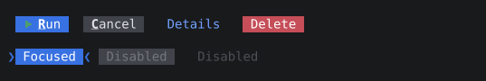 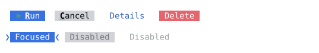

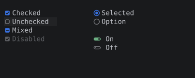 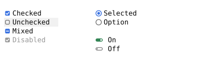

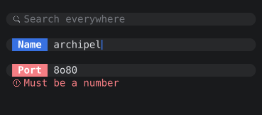 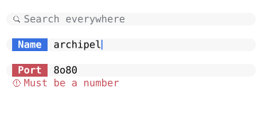

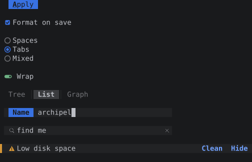 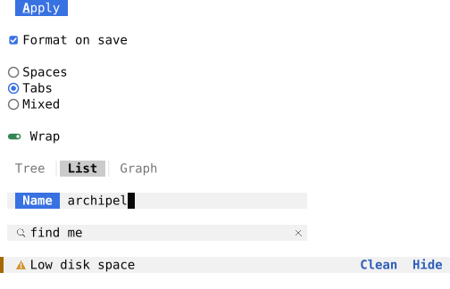

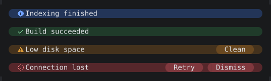 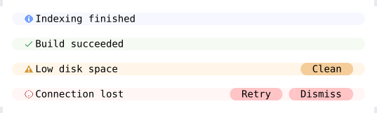

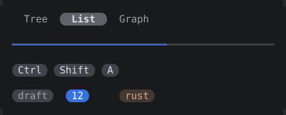 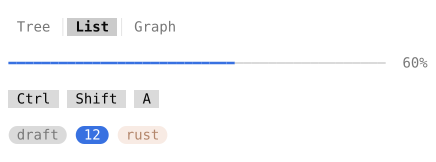

### Lists, trees, tables and speed search

Up/Down move (no wrap), Shift extends, Ctrl moves the lead, Ctrl+Space toggles, Home/End and
PageUp/PageDown jump, Ctrl+A selects all, Enter activates. In a tree Right expands or selects the
first child, Left collapses or selects the parent. Typing starts the speed search (letters,
digits and ``*_-+"'/.#$>:,;?!@%^&``): it matches camel humps and word starts, highlights the
matches, selects the first match, Up and Down move between matches, Backspace edits, Ctrl+Backspace
clears, Esc closes it, and Enter, Left, Right and Page keys close it and act.

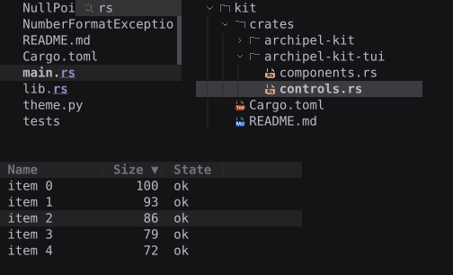 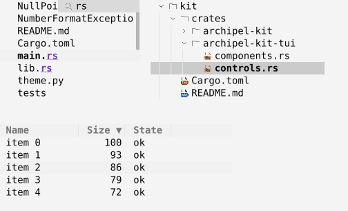

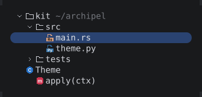 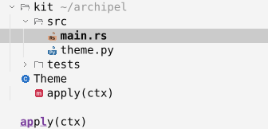

### Popups and menus

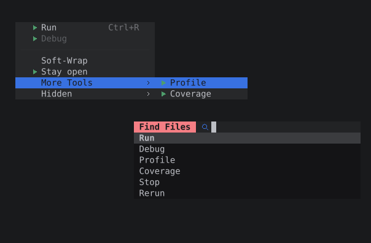 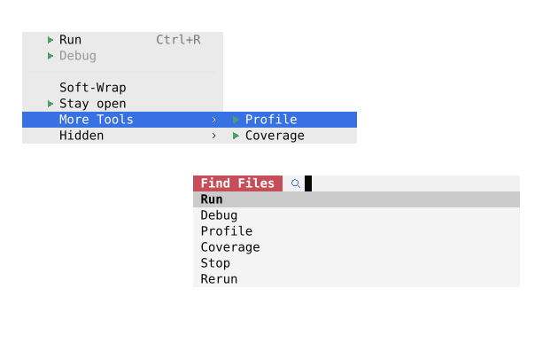

### Toolbar, tabs and combo box

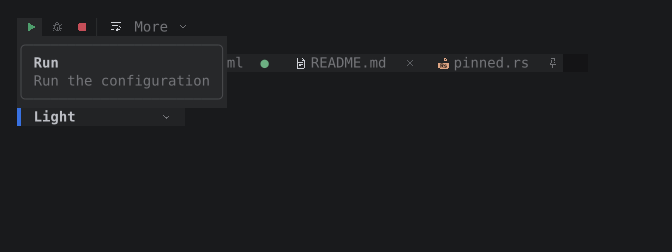 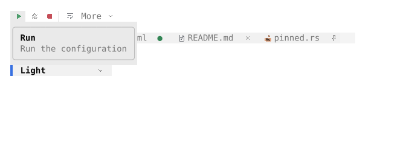

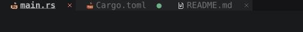 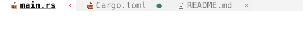

### Tool windows

`Workbench` draws the title lines and separators around the editor and implements the key and
mouse rules; you draw the content into the rectangles it returns. There is no stripe column
unless you ask for one with `Workbench::stripes(true)` (shown in the second pair of images).

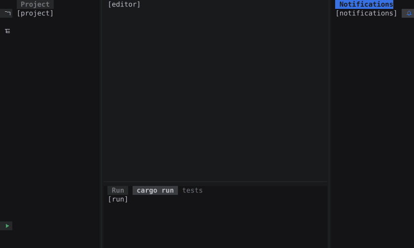 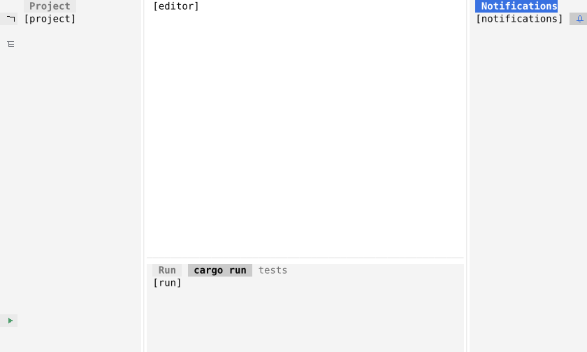

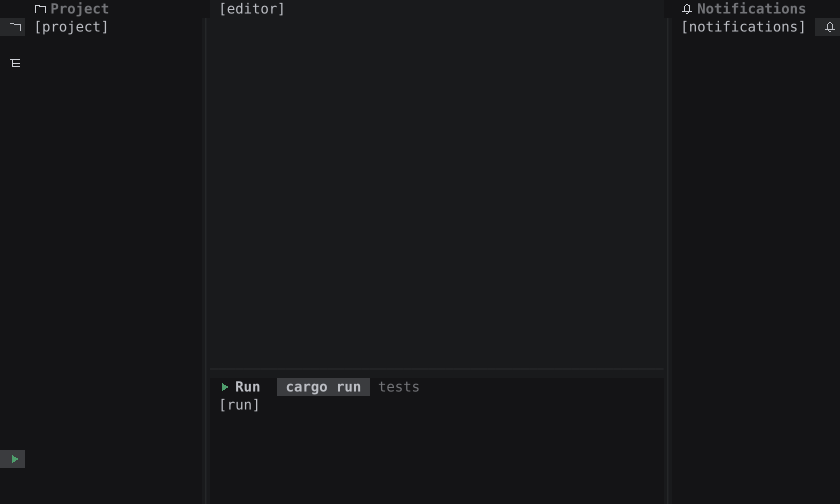 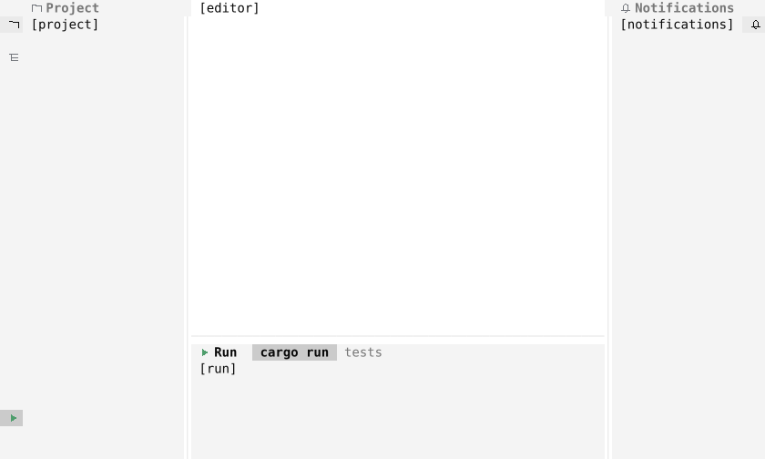

### Status bar

 

### GUI-faithful chrome

An app writes its chrome once, as props of [`archipel-kit-model`](../../crates/archipel-kit-model)
(`Toolbar`, `MenuBar`, `ToolStripe`, `PanelHeader`, `TabBar`, `StatusBar`: plain data with
stable ids, semantic `Tone`s, `IconKey`s and `Shortcut`s, no colors and no pixels), and lets the
egui kit or this crate render them. The components of this crate take the props, draw them and
return the events of the same model (`ToolbarEvent`, `MenuEvent`, `StripeEvent`,
`PanelHeaderEvent`, `TabEvent`, `StatusBarEvent`), so the application decides what a click means.
`Look::gui(theme)` maps the tokens of `Theme::colors` one to one to 24-bit colors, blending
translucent ones over the surface they sit on; the terminal's 256-color mode quantizes in
CIELAB (`quantize`). Nothing here has modes: the keys are the GUI's.

```
use archipel_kit_model::{Toolbar, ToolbarButton, ToolbarItem, Tone};
use archipel_kit_tui::bar::ToolbarControl;
use archipel_kit_tui::ratatui::{buffer::Buffer, layout::Rect};
use archipel_kit_tui::{Glyph, Id, Look, Runtime};

let mut bar = Toolbar::new("main");
bar.trailing.push(ToolbarItem::Button(
    ToolbarButton::new("run", Glyph::Run, "Run").tone(Tone::Run),
));
let mut rt = Runtime::new(Look::gui(archipel_kit_tui::Theme::dark()));
let area = Rect::new(0, 0, 40, 1);
let mut buf = Buffer::empty(area);
let mut control = ToolbarControl::new(Id::new("toolbar"));
rt.begin_frame(area);
control.draw(&mut rt, &bar, area, &mut buf);
assert!(control.rect_of("run").is_some());
```

The main menu: a click on a title opens its menu below it, hovering another title switches, Left
and Right move between titles, Esc closes the menu and the bar returns to the toolbar.

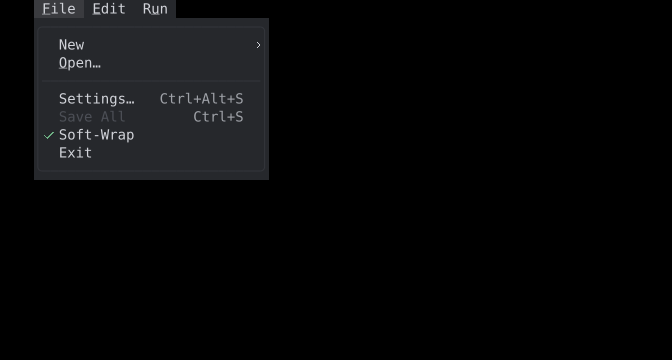

Editor tabs: the selected tab is filled and underlined, a dot marks unsaved changes and turns into
the close button under the pointer, a pin marks a pinned tab, a preview tab is italic and a file with
errors has a curly underline.

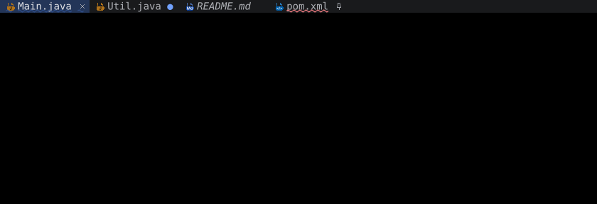

A tool window header with content tabs and counts:

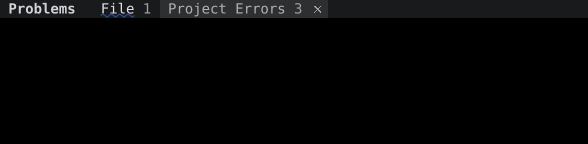

The status bar: breadcrumbs at the left, the widgets at the right in the GUI's order; the widget
with the lowest priority is dropped first when the row is narrow.

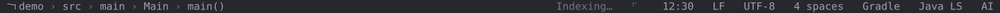

### Dialogs, notifications and tooltips

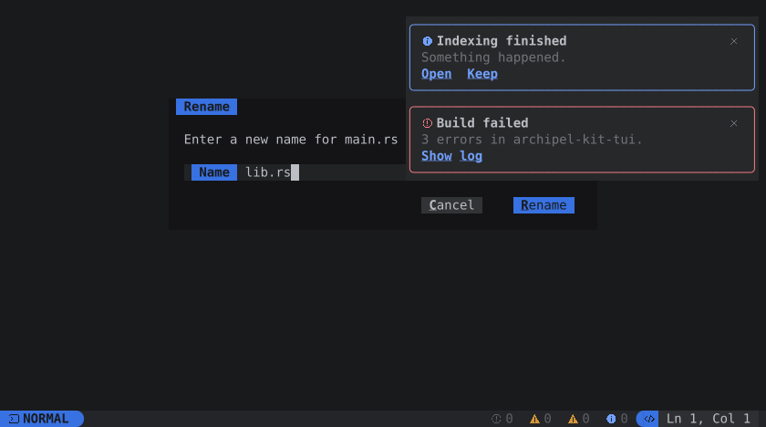 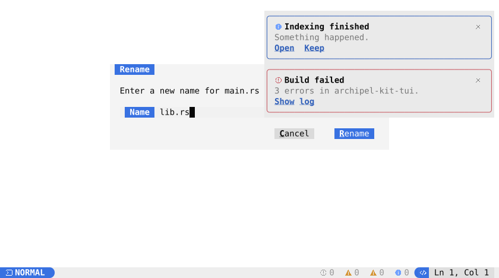

### Search Everywhere

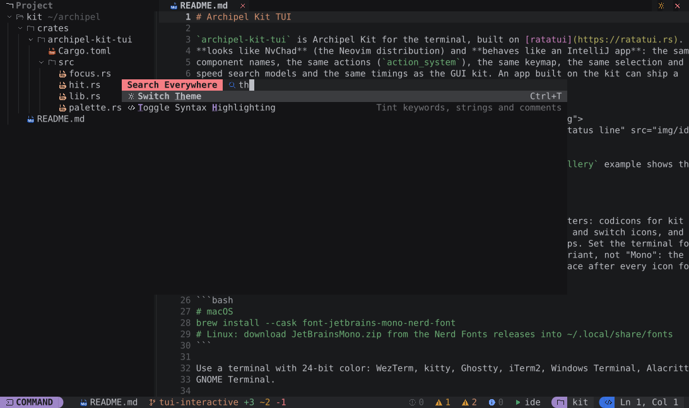

### Icons

`LanguageIcon`, `SymbolIcon`, and `Look::glyph` with `Look::glyph_color`. The character tables are
in `archipel_kit_tui::glyphs`: every `Glyph`, `Language` and `SymbolKind` has a Nerd Font
character, and a test checks that none is missing.

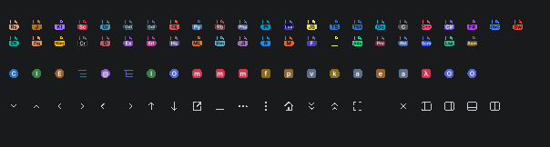 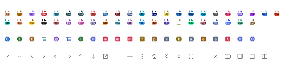

## The code editor

`editor::EditorComponent` is the GUI's `EditorComponent` for the terminal. It runs on the
**same model** (`archipel_kit::editor::model::Editor`: document, carets, undo, folding, scroll
math, search), so it behaves exactly like the GUI editor, which behaves like the IntelliJ
editor: every key goes through `input::key_stroke` and the GUI keymap
(`model::editor_action_for`) to an `EditorAction` and `Editor::execute`; typed text is
`EditorAction::Type`; the clipboard, the mouse and the find bar call the same model functions as
the GUI. It looks like NvChad.

```rust
use archipel_kit::editor::model::Editor;
use archipel_kit_tui::editor::{CodeHighlighter, EditorComponent, EditorState};
use archipel_kit_tui::ratatui::{buffer::Buffer, layout::Rect};
use archipel_kit_tui::{Event, Id, Runtime};

const CODE: Id = Id::new("code");

struct File {
    editor: Editor,
    state: EditorState,
    highlighter: CodeHighlighter,
}

impl File {
    fn event(&mut self, rt: &mut Runtime, event: &Event) {
        let out = EditorComponent::new(CODE, &mut self.editor)
            .highlighter(&self.highlighter)
            .handle(rt, &mut self.state, event);
        if out.text_changed { /* mark the tab modified */ }
    }

    fn draw(&mut self, rt: &mut Runtime, area: Rect, buf: &mut Buffer) {
        EditorComponent::new(CODE, &mut self.editor)
            .highlighter(&self.highlighter)
            .show(rt, &mut self.state, area, buf);
    }
}
```

`EditorState` keeps what only the view knows: the scroll position, the find bar and its
history, a mouse gesture in progress, the completion menu, a hint. The options are the GUI's:
`viewer`, `line_numbers`, `wrap` (soft wrap), `folding`, `show_whitespace`, `indent_guides`,
`right_margin`, `gutter_icons`, `change_markers`, `highlights`, `completer`,
`gutter_click_selects_line`, `bracket_folding`, `enabled`, `tab_indents`, `stick_to_bottom`,
`scroll_to_line`, `placeholder`, `keymap_os`, plus `virtual_text` and `scrollbar`. What a frame
and an event report is in `EditorOutput`: `text_changed`, `carets_moved`, `navigation`,
`gutter_clicks`, `gutter_hover`, `hint`, `hover`, `fold_preview`, `stripe_hover`, `selection`, `caret_cell`,
`line_count`, `visible_lines`, `matches` and `completed`. The editor has every feature of the GUI
`EditorComponent`; `docs/tui-editor-parity.md` is the audit, and the logic both share is
`archipel_kit::editor::logic`. Any `SyntaxHighlighter` of the
GUI kit colors the text with the theme's editor scheme in 24-bit color; `CodeHighlighter` is a
small one for Rust, Markdown and TOML. `editor::cursor_position` gives `Ln, Col` for the status
line.

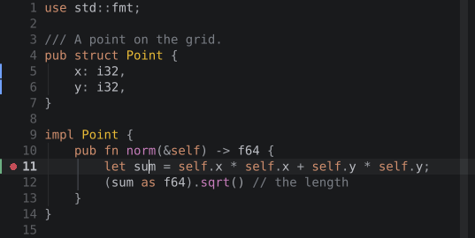 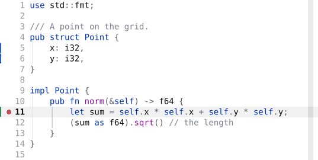

What it draws:

- **Gutter**: the sign column (`▎` in green, blue and red for added, modified and deleted lines,
  breakpoint and bookmark icons in their tone), the number column in grey with the caret lines
  bright and bold, the fold markers (chevrons), then the text.
- **Text**: the cursor line on `black2`; the selection as cell backgrounds on `one_bg3` (no
  rounding; `one_bg2` without focus); search matches, occurrences of the selected word and the
  matched brace in the scheme's colors; indent guides `│` in the `line` color (the guide of the
  caret's block in the scheme's selected-guide color); whitespace as `·` and `→`; the right
  margin column tinted; a collapsed region as a `{…}` pill.
- **Carets**: the primary caret is the real terminal cursor, a bar while inserting and a block
  in overwrite mode (DECSCUSR; the shape is restored on exit). Other carets are reversed cells.
- **Diagnostics**: `highlights` are underlined in the severity color with SGR `4:3` (undercurl)
  and color `58` where the terminal has them (`runtime::detect_undercurl`, override with
  `ARCHIPEL_UNDERCURL=0/1`), a plain colored underline elsewhere; the message can follow the
  line as virtual text. A one-cell scrollbar column shows the thumb and a mark per highlight and
  find match, like the GUI's error stripe.

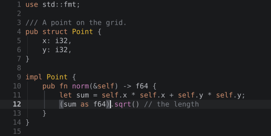 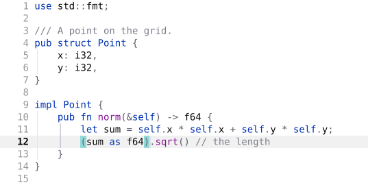

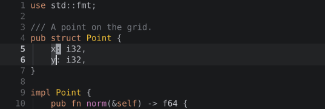 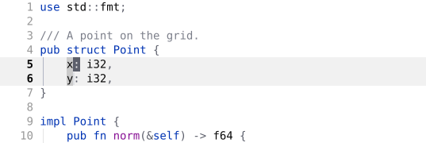

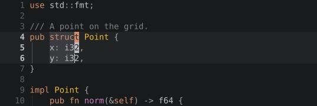 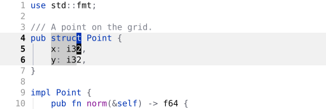

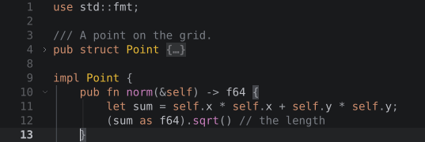 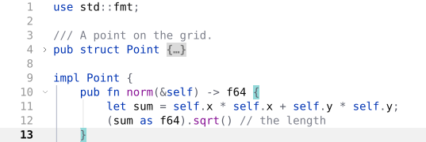

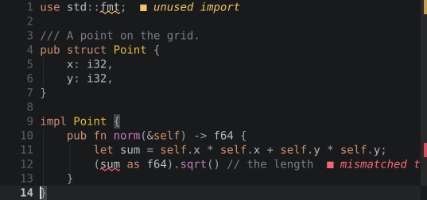 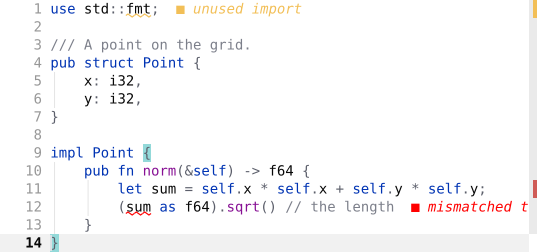

### Hover

Resting the pointer on the text for 500 ms opens a float with the messages of the diagnostics
under it, most severe first, as Neovim's LSP hover does; `EditorOutput::hover` reports the same
rest for your own tooltip. Resting 300 ms on a collapsed `{…}` previews the folded lines
(`fold_preview`); resting on a gutter icon shows its name; resting on a mark of the scrollbar
column shows its message (`stripe_hover`). A key or a press puts the float away until the pointer
moves on. Wake the loop with `EditorState::deadline`, the delay is running until then.

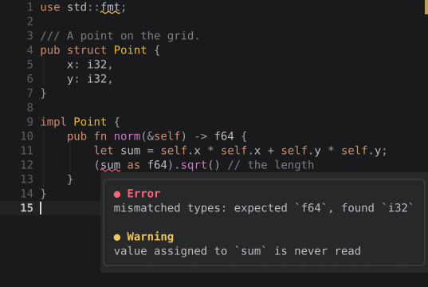 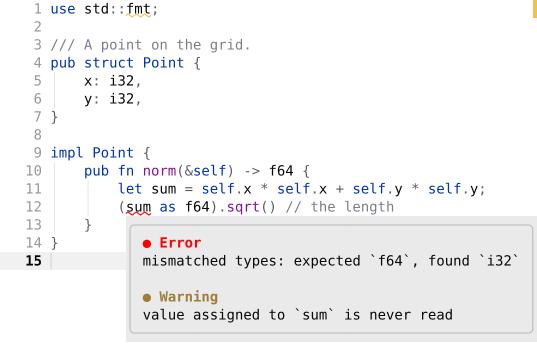

 

### Keys

All keys are the GUI editor's (`docs/editor-model.md` has the keymap). A legacy terminal cannot
send some of them, so the editor also understands fallbacks; they work in kitty-protocol
terminals too. The `Ctrl+K` chords are in `input::terminal_keymap`, so which-key lists them
after Ctrl+K.

| Action | GUI shortcut | Terminal fallback |
|---|---|---|
| Extend / shrink selection | Ctrl+W / Ctrl+Shift+W | Alt+Up / Alt+Down, or Ctrl+K then E / Shift+E (Ctrl+W is the window leader) |
| Move line up / down | Alt+Shift+Up / Down | Ctrl+K then Up / Down |
| Move statement up / down | Ctrl+Shift+Up / Down | Ctrl+K then Shift+Up / Shift+Down |
| Select next occurrence / unselect | Alt+J / Alt+Shift+J | Ctrl+K then S / Shift+S (Option+J types a symbol on macOS) |
| Select all occurrences | Ctrl+Alt+Shift+J | Ctrl+K then L |
| Clone caret above / below | double Ctrl + Up / Down | Ctrl+K then Ctrl+Up / Ctrl+Down |
| Add carets to selected lines | Alt+Shift+G | Ctrl+K then G |
| Column selection mode | Alt+Shift+Insert | Ctrl+K then C |
| Start new line before | Ctrl+Alt+Enter | Ctrl+K then O |
| Split line | Ctrl+Enter | Ctrl+J (what a legacy terminal sends for Ctrl+Enter) |
| Join lines | Ctrl+Shift+J | Ctrl+K then J |
| Toggle case | Ctrl+Shift+U | Ctrl+K then U |
| Move to matching brace | Ctrl+Shift+M | Ctrl+K then M |
| Code block start / end (with Shift: select) | Ctrl+[ / Ctrl+] | Ctrl+K then [ / ] (Ctrl+[ is Escape) |
| Comment with line comment | Ctrl+/ | Ctrl+7 (what a legacy terminal sends for Ctrl+/) |
| Comment with block comment | Ctrl+Shift+/ | Ctrl+K then / |
| Delete to word start | Ctrl+Backspace | Ctrl+H (what some terminals send) |
| Expand / collapse region | Ctrl++ / Ctrl+- | Ctrl+K then = / - (Alt: recursively, Shift: all) |
| Paste without formatting | Ctrl+Alt+Shift+V | Ctrl+K then V |
| Redo | Ctrl+Shift+Z | Ctrl+K then Z |
| Completion | Ctrl+Space | none needed |

Paste arrives as the terminal's bracketed paste and goes through `EditorAction::Paste`; text
copied with an empty selection (whole lines) is pasted above the caret line, also when it comes
back through the terminal's paste. Copy and Cut publish with OSC 52. Escape that has nothing to
clear (one caret, no selection, no find bar, no menu) is not consumed, so the app can use it.

### Mouse

| Gesture | Effect |
|---|---|
| Click, double click, triple click | caret, word, line |
| Drag | selects; beyond the edge the view autoscrolls on the GUI's timer (call `tick` and use `EditorState::deadline`) |
| Shift+click | extends the selection, by words or lines after a double or triple click |
| Alt+drag, middle drag | column selection (where the terminal reports Alt) |
| Alt+Shift+click | adds a caret, or removes the one there |
| Ctrl+click (Cmd on macOS) | reported as a `NavigationRequest` (Ctrl+Alt for the implementation); Ctrl+B and Ctrl+Alt+B (Cmd+B) ask for it from the keyboard |
| Middle click | pastes the mouse selection (Linux) |
| Wheel, Shift+wheel | scrolls three rows, four columns sideways |
| Click on a collapsed `{…}` | expands it |
| Line number | a click is reported as a `GutterClick`, a drag selects lines (with `gutter_click_selects_line`, the click selects the line); Shift+click extends by lines |
| Fold marker | toggles the region (Alt: with the nested ones) |
| Gutter icon | reported as a `GutterClick` |
| Scrollbar column | a click on a mark moves the caret there and centers it; elsewhere it scrolls there |
| Right press | moves the caret unless it is in the selection; `context_menu` says where |

### Find and replace

Ctrl+F opens the find bar (a single-line selection becomes the query, a multi-line selection the
scope), Ctrl+R the replace row. It is an NvChad prompt row at the top of the editor: a colored
title pill, the prompt, the `n/m` status, the Match Case, Words and Regex toggles (Alt+C, Alt+W,
Alt+X), previous, next and close. Typing selects the first match from the caret (the current
match is the selection, drawn inverted and bold so it stands out from the other matches, which
only carry the search tint); clearing the query puts the carets and the view back. Enter, Down and
F3 go to the next match, Shift+Enter, Up and Shift+F3 to the previous one; past the last match
the first press shows a hint, the second wraps. Enter in the replace field replaces and selects
the next match, Alt+A replaces all as one undo step, Alt+P preserves case. Alt+Enter selects all
matches with one caret each, Ctrl+Enter (Ctrl+J in a legacy terminal) remembers the query and
goes back to the text, Tab moves between the fields, Alt+Down opens the history of queries,
Escape closes the bar.

 

 

### Completion

With a `completer` (the kit's `Completer` trait), typing opens an nvim-cmp style menu under the
caret: a kind icon (the item's own icon when it has one), the label with the typed characters
highlighted, the tail text and the type in grey, bold and struck-out items, the selected row in
the accent. It is the GUI list's state machine (`logic::lookup::LookupState`), so it behaves like
the IntelliJ lookup: the typed text filters and ranks by camel humps, middle matching and exact
case, recently chosen items first (`Completer::recency`); Ctrl+Space asks for everything, a lone
answer goes in at once and a second Ctrl+Space asks for more (`complete_extended`); Backspace on
an empty prefix and the caret leaving the prefix close it.

Keys while it is open: Up and Down move and wrap, PageUp and PageDown jump, Enter inserts, Tab
replaces the identifier after the caret too, `.` `,` `;` `=` space `:` `(` insert the item and are
typed after it, Ctrl+Q (Ctrl+J, F1) shows the documentation of the selected item beside the menu,
Escape closes, a click picks, the wheel scrolls. The item goes in at every caret as one undo
step, and `EditorOutput::completed` reports it for `LookupStats`. `{{variable}}` templates work
with `TemplateHighlighter` for the colors and `template_at` in the completer.

 

 

### In the IDE example

 

Files from the project tree open in editor tabs; the tab shows the modified dot until Ctrl+S;
the status line shows `Ln, Col` of the primary caret and the mode block says `EDIT`, or `VIEW`
with the Read-Only toggle (Find Action or the editor's context menu).

### Differences from the GUI editor

- **Cells, not pixels.** A click goes to the cell's position (the first half of a wide character
  is before it); a drag starts as soon as the pointer leaves the cell. Columns are cells: tabs
  go to tab stops and wide characters take two, while the model counts them as one column for
  Up and Down.
- **No animation and no blinking**: scrolling jumps; the terminal draws the cursor.
- **Soft wrap** breaks at the last cell, not at word boundaries.
- **The selection** keeps its fill without rounded corners: the Islands radius is a sixth of a
  line, below a cell.
- **Hover floats** are drawn by the editor itself (the GUI reports the hover and the application
  shows the tooltip); `EditorOutput::hover` is there for your own tooltip as well.
- **The find query is one line**: Ctrl+Shift+Enter (a line break in the query) is not there.
- **Some keys need a fallback** (above); Ctrl+W is the terminal's window leader in the IDE, so
  extend selection is Alt+Up or Ctrl+K then E there.
- **The terminal decides** whether Alt and Shift reach the mouse, whether undercurl shows, and
  how the cursor looks.

## Terminal limits

- **Keys**: legacy terminals send Ctrl+Shift+letter as Ctrl+letter, no Ctrl+Tab, no Ctrl+digit,
  and no Super; on macOS Option+digit types a symbol. The fallbacks above cover the bound
  actions. With the kitty keyboard protocol (kitty, WezTerm, Ghostty, foot, recent Alacritty and
  iTerm2) every combo works, key release is reported, and double Shift can be detected.
- **Mouse**: terminals report cells, not pixels. Hover needs any-motion tracking (on). Some
  terminals keep Shift+drag for their own selection.
- **Clipboard**: copy uses OSC 52 (kitty, WezTerm, iTerm2, Ghostty, Alacritty, Windows Terminal,
  tmux with `set-clipboard on`); paste arrives through the terminal's own paste.
- **Cursor and focus**: text fields draw their caret as a block; the editor uses the real
  terminal cursor (`Runtime::set_cursor`); focus events need terminal support, without
  them balloon timers run while the window is in the background.
- **Fonts**: icons need a Nerd Font.

## Testing

`archipel_kit_tui::testing` renders without a terminal:

- `Harness` runs an `App` with synthetic events (`press`, `type_text`, `click`, `double_click`,
  `drag`, `scroll`, `hover`, `advance`) and a manual clock; `find` and `screen` read the result.
- `render(width, height, |area, buf| …)` draws a widget into a fresh buffer, `lines(&buf)` gives
  the text of each row, and `snapshot(name, &buf)` compares the buffer, as SVG, with
  `docs/tui/img/<name>.svg` (`UPDATE_SNAPSHOTS=1 cargo test -p archipel-kit-tui` accepts
  changes). The SVG snapshots need no GPU.

```rust
use archipel_kit_tui::components::Button;
use archipel_kit_tui::ratatui::widgets::Widget;
use archipel_kit_tui::testing::{lines, render};
use archipel_kit_tui::Look;

let look = Look::dark();
let buf = render(12, 1, |area, buf| Button::secondary(&look, "OK").render(area, buf));
assert_eq!(lines(&buf), ["  OK"]);
```

## What is next

- Backend-agnostic kit modules so the TUI reuses more of the GUI's logic (see the extraction list
  in the TUI hand-off notes): popup chain, notification timers, speed search over rows, tool window
  pane model.
- `archipel-theme` crate: the theme and tokens without egui, so the TUI does not compile egui.
